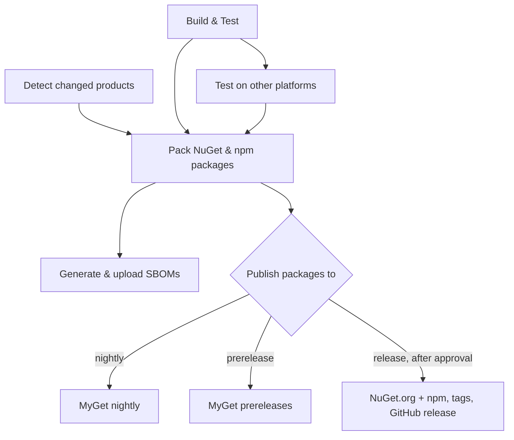

# Contributing to Umbraco.AI

This guide explains how to contribute to the Umbraco.AI monorepo, covering branch naming conventions, git workflows, and release processes.

## Table of Contents

- [Getting Started](#getting-started)
- [Branch Naming Convention](#branch-naming-convention)
- [Development Workflow](#development-workflow)
- [Pull Request Process](#pull-request-process)
- [Release Process](#release-process)
- [CI/CD Pipeline](#cicd-pipeline)
- [Coding Standards](#coding-standards)

## Getting Started

### Prerequisites

- .NET 10.0 SDK
- Node.js 20.x
- Git
- SQL Server or SQLite (for database development)
- IDE: Visual Studio 2022, VS Code, or JetBrains Rider

### Initial Setup

```bash
# Clone the repository
git clone https://github.com/umbraco/Umbraco.AI.git
cd Umbraco.AI

# Run setup script (creates unified solution + demo site)
.\scripts\install-demo-site.ps1  # Windows
./scripts/install-demo-site.sh   # Linux/Mac

# Configure git hooks (enforces branch naming and commit message syntax)
.\scripts\setup-git-hooks.ps1  # Windows
./scripts/setup-git-hooks.sh   # Linux/Mac

# Open unified solution
start Umbraco.AI.local.slnx
```

### Repository Structure

```
Umbraco.AI/                    # Monorepo root
├── Umbraco.AI/                # Core AI layer (1.x)
├── Umbraco.AI.Agent/          # Agent add-on (1.x)
├── Umbraco.AI.Agent.UI/       # Agent UI library (1.x)
├── Umbraco.AI.Agent.Copilot/  # Agent copilot UI (1.x)
├── Umbraco.AI.Prompt/         # Prompt add-on (1.x)
├── Umbraco.AI.OpenAI/         # OpenAI provider (1.x)
├── Umbraco.AI.Anthropic/      # Anthropic provider (1.x)
├── Umbraco.AI.Amazon/         # Amazon Bedrock provider (1.x)
├── Umbraco.AI.Google/         # Google Gemini provider (1.x)
├── Umbraco.AI.MicrosoftFoundry/ # Microsoft AI Foundry provider (1.x)
├── demos/                     # Demo sites (generated, one per major version: demos/vN/)
└── docs/                      # Shared documentation
```

## Branch Naming Convention

**All branches MUST follow these patterns.** This is enforced by git hooks and CI/CD.

### Valid Branch Patterns

| Pattern                     | Description                          | Example                             |
| --------------------------- | ------------------------------------ | ----------------------------------- |
| `vN/dev`                    | Active development for version N     | `v18/dev`                           |
| `vN/main`                   | Last released state for version N    | `v18/main`                          |
| `vN/topic/<anything>`       | Any work branch for version N        | `v18/topic/add-embeddings`          |
| `vN/release/<anything>`     | Release preparation for version N    | `v18/release/2026.06.1`             |
| `vN/hotfix/<anything>`      | Hotfix branch for version N          | `v17/hotfix/2026.06.1`              |
| `claude/<anything>`         | Claude Code automation branches      | `claude/add-streaming-abc123`       |

### Currently Active Version Lines

| CMS Version | AI Branches               | Policy                |
| ----------- | ------------------------- | --------------------- |
| v18 (STS)   | `v18/dev` / `v18/main`   | Features + bug fixes  |
| v17 (LTS)   | `v17/dev` / `v17/main`   | Features + bug fixes  |

The GitHub default branch always points to the latest version's `dev` (currently `v18/dev`).

### Recommended Naming Conventions

**Release branches:** `vN/release/YYYY.MM.N`

- `N` is the CMS major version
- `YYYY.MM` = Year and month of the release
- Trailing `.N` = Incrementing release number within that month
- Example: `v18/release/2026.01.1` for the first January 2026 release on v18

**Hotfix branches:** `vN/hotfix/YYYY.MM.N`

- Example: `v17/hotfix/2026.01.1` for the first hotfix in January 2026 on v17

**Topic branches:** `vN/topic/<descriptive-name>`

Use a topic branch for any piece of work: a feature, a fix, a refactor, docs or tooling.

- Example: `v18/topic/add-streaming-support`
- Example: `v17/topic/backport-split-view-fix`

`vN/feature/<name>` is the old name for this. Branches already open under it still push and build, but
new branches should use `vN/topic/`.

### Examples

**Correct:**

```bash
v18/topic/add-streaming-support
v18/topic/improve-context-handling
v17/topic/backport-split-view-fix
v18/release/2026.01.1      # Calendar-based (recommended)
v17/hotfix/2026.01.1       # Calendar-based with sequence
```

**Incorrect:**

```bash
topic/add-streaming         # Missing version prefix
release/2026.01             # Missing version prefix
dev                         # Bare dev (no longer valid)
main                        # Bare main (no longer valid)
support/17.x                # Old maintenance convention
```

### Enforcement

Branch naming is enforced at two levels:

1. **Git Hooks** (`.githooks/pre-push`): Local validation before push — blocks pushes from branches that don't match the `vN/` convention
2. **Azure DevOps CI/CD**: Trigger patterns only run on `v*/dev`, `v*/main`, `v*/release/*`, `v*/hotfix/*`, `v*/topic/*` (plus the old `v*/feature/*`)

### Git Hooks for Release Manifest Protection

The repository includes several git hooks to manage `release-manifest.json` lifecycle:

**Protection on release/hotfix branches:**

- **pre-merge-commit hook**: Automatically restores `release-manifest.json` if it gets deleted during a merge to a `release/*` or `hotfix/*` branch (e.g., when merging from `dev`)
- **merge driver**: Preserves `release-manifest.json` when there are content conflicts (defense-in-depth)

**Cleanup on long-term branches:**

- **post-merge hook**: Automatically removes `release-manifest.json` after merging to `main`, `dev`, or `support/*` branches (these branches should never have the manifest file)

This ensures:

- ✅ Release branches always keep their manifest during merges
- ✅ Long-term branches never accumulate manifest files
- ✅ No manual intervention needed

To bypass git hooks temporarily (not recommended):

```bash
git push --no-verify
```

## Development Workflow

### Feature Development (Single Product)

```bash
# 1. Create a topic branch from the appropriate vN/dev
git checkout v17/dev
git pull origin v17/dev
git checkout -b v17/topic/add-embeddings

# 2. Make changes in the product directory
# Edit: Umbraco.AI/src/Umbraco.AI.Core/...

# 3. Build and test
dotnet build Umbraco.AI/Umbraco.AI.slnx
dotnet test Umbraco.AI/Umbraco.AI.slnx

# 4. Test in demo site
cd demos/v17/Umbraco.AI.DemoSite
dotnet run

# 5. Commit changes
git add .
git commit -m "feat(core): add embedding support

Implements IChatClient.EmbeddAsync using M.E.AI abstractions"

# 6. Push and create PR
git push -u origin v17/topic/add-embeddings
```

### Feature Development (Cross-Product)

When a feature spans multiple products (e.g., Core + Agent):

```bash
# 1. Create a topic branch from the appropriate vN/dev
git checkout v17/dev
git checkout -b v17/topic/shared-context

# 2. Make changes to both products
# Edit: Umbraco.AI/src/Umbraco.AI.Core/...
# Edit: Umbraco.AI.Agent/src/Umbraco.AI.Agent.Core/...

# 3. Build unified solution (tests everything together)
dotnet build Umbraco.AI.local.slnx

# 4. Test in demo site
cd demos/v17/Umbraco.AI.DemoSite
dotnet run

# 5. Commit atomic changes
git add .
git commit -m "feat(core,agent): add shared context handling

- Core: Add IContextProvider interface
- Agent: Implement context sharing between agents"

# 6. Push and create PR
git push -u origin v17/topic/shared-context
```

**Note:** Use a descriptive branch name that reflects the scope of the work.

### Frontend Development

```bash
# Watch all frontends in parallel (hot reload)
npm run watch

# Or watch specific product
npm run watch:core
npm run watch:agent

# Generate OpenAPI clients (demo site must be running)
npm run generate-client
```

### Working with Project References

By default, all products use **project references** to Core (changes visible immediately):

```xml
<!-- Agent.Core.csproj -->
<ProjectReference Include="..\..\..\Umbraco.AI\src\Umbraco.AI.Core\Umbraco.AI.Core.csproj"
                  Condition="'$(UseProjectReferences)' == 'true'" />
```

This means:

- **Local builds**: Agent/Prompt/Providers automatically use your local Core changes
- **Distribution builds**: CI/CD builds with `UseProjectReferences=false` for package references

### Running Tests

```bash
# Run tests for specific product
dotnet test Umbraco.AI/Umbraco.AI.slnx
dotnet test Umbraco.AI.Agent/Umbraco.AI.Agent.slnx

# Run all tests
dotnet test Umbraco.AI.local.slnx
```

### Local Packing

Products with a `Web.StaticAssets` project ship a Bellissima frontend bundle alongside their .NET assemblies. When packing locally, the frontend **must be built first** — `dotnet pack` does not invoke the npm build, and there is no error if the frontend output is missing.

The required order is:

```bash
# 1. Install npm workspace dependencies (once, or after lockfile changes)
npm install

# 2. Build the target product's frontend (and any frontend dependencies)
#    Targets: core, prompt, agent, agent-ui, copilot
npm run build:agent

# 3. Pack the .NET solution
dotnet pack Umbraco.AI.Agent/Umbraco.AI.Agent.slnx
```

**Why this matters:** if you skip step 2, the resulting `*.Web.StaticAssets.nupkg` will contain only `lib/net10.0/*.dll` — its `staticwebassets/` folder will be empty. The backoffice composers will register at runtime but no UI will render, and there is no build-time signal that anything is wrong.

CI handles this automatically via `.github/actions/build-product/action.yml` (the `has-frontend` gate), so this only affects local pack flows.

**Frontend dependency order:** `npm run build` runs the workspace targets sequentially (`core → prompt → agent → agent-ui → copilot`). When packing an add-on locally, build `core` first if you haven't already, since add-on frontends consume the core bundle.

**Troubleshooting — "my package's UI doesn't render after `dotnet pack`":** unpack the `*.Web.StaticAssets.nupkg` (it's a zip) and look for a `staticwebassets/` folder containing files under `App_Plugins/`. If that folder is empty or missing, the frontend wasn't built before pack — go back to step 2.

## Pull Request Process

### PR Title Format

Use conventional commits format:

```
<type>(<scope>): <description>

Types: feat, fix, docs, chore, refactor, test, perf
Scopes: core, agent, prompt, openai, anthropic
```

**Examples:**

```
feat(core): add streaming chat support
fix(agent): resolve context memory leak
docs(prompt): update README with examples
chore(core,agent): update dependencies
```

### PR Description Template

```markdown
## Summary

Brief description of what this PR does.

## Changes

- List of key changes
- Another change

## Testing

- [ ] Unit tests pass
- [ ] Integration tests pass
- [ ] Tested in demo site
- [ ] Frontend builds successfully (if applicable)

## Breaking Changes

None / List any breaking changes

## Related Issues

Closes #123
```

### PR Checklist

Before submitting a PR:

- [ ] Branch name follows convention (`vN/topic/<anything>`)
- [ ] Code follows [coding standards](CLAUDE.md#coding-standards)
- [ ] All tests pass
- [ ] Frontend builds (if frontend changes)
- [ ] Documentation updated (if needed)
- [ ] CLAUDE.md updated (if architecture changes)
- [ ] No console errors or warnings

### Review Process

1. **Automated Checks**: GitHub Actions runs branch validation + unit tests
2. **Code Review**: At least one team member must approve
3. **CI/CD**: Azure DevOps builds affected products
4. **Merge**: Squash merge to main (keeps history clean)

## Release Process

Each product is versioned and released independently using Nerdbank.GitVersioning (NBGV).

### Version Numbers

| Product                     | Version Scheme    | Current |
| --------------------------- | ----------------- | ------- |
| Umbraco.AI (Core)           | 1.x (independent) | 1.0.0   |
| Umbraco.AI.Agent            | 1.x (independent) | 1.0.0   |
| Umbraco.AI.Prompt           | 1.x (independent) | 1.0.0   |
| Umbraco.AI.OpenAI           | 1.x (independent) | 1.0.0   |
| Umbraco.AI.Anthropic        | 1.x (independent) | 1.0.0   |
| Umbraco.AI.Amazon           | 1.x (independent) | 1.0.0   |
| Umbraco.AI.Google           | 1.x (independent) | 1.0.0   |
| Umbraco.AI.MicrosoftFoundry | 1.x (independent) | 1.0.0   |

### Release Workflow

#### 1. Create Release Branch

```bash
git checkout main
git pull origin main
git checkout -b release/2026.01
```

#### 2. Define Release Manifest

Use the interactive script to generate `release-manifest.json`:

```bash
# Windows
.\scripts\generate-release-manifest.ps1

# Linux/Mac
./scripts/generate-release-manifest.sh
```

The script will scan for all products and present an interactive multiselect interface. Alternatively, create the file manually:

```json
["Umbraco.AI", "Umbraco.AI.OpenAI"]
```

#### 3. Update Versions

Edit each product's `version.json` in the manifest:

```json
{
    "version": "1.1.0",
    "assemblyVersion": {
        "precision": "build"
    },
    "publicReleaseRefSpec": ["^refs/heads/main$", "^refs/heads/release/", "^refs/heads/hotfix/"]
}
```

```bash
git add release-manifest.json Umbraco.AI/version.json
git commit -m "chore(release): prepare 2026.01"
git push -u origin release/2026.01
```

#### 4. CI/CD Build Pipeline

Azure DevOps detects the `release/*` branch pattern:

- Enforces `release-manifest.json` (CI fails if any changed product is missing from the list)
- Builds and tests, then packs only the listed products
- Publishes three artifacts:
    - `all-nuget-packages` - Contains all NuGet packages (.nupkg)
    - `all-npm-packages` - Contains all npm packages (.tgz)
    - `pack-manifest` - Contains metadata for each package (name, version, type)

A push never publishes anything. Publishing is a separate run, below.

#### 5. Publish a Pre-Release (Optional)

To test before going public, queue a run of the `Umbraco.AI` pipeline on the release branch with **Publish packages to** set to `prerelease`. It publishes the NuGet packages to the **MyGet** prereleases feed, with no approval step.

```bash
/release-publish   # asks for the target; choose prerelease
```

**MyGet URL:** `https://www.myget.org/F/umbraco-ai/api/v3/index.json`

#### 6. Test Pre-Release

Validate the pre-release packages work correctly:

**Option A: Automated Test Site (Recommended)**

Use the package test site script to create a fresh Umbraco site with all packages:

```bash
# Windows
.\scripts\install-package-test-site.ps1 -Feed prereleases -Force

# Linux/Mac
./scripts/install-package-test-site.sh --feed=prereleases --force
```

This creates a site at `demos/v17/Umbraco.AI.PackageTestSite` with:
- All Umbraco.AI packages from MyGet prereleases feed
- Clean starter kit
- Configured package source mapping

**Option B: Manual Testing**

```bash
# Add MyGet feed
dotnet nuget add source https://www.myget.org/F/umbraco-ai/api/v3/index.json -n UmbracoAI

# Install pre-release package
dotnet add package Umbraco.AI.Core --version 1.1.0-*

# Install pre-release npm package
npm install @umbraco-ai/core@next
```

**Verify the site:**

```bash
cd demos/v17/Umbraco.AI.PackageTestSite  # or your test site folder
dotnet run
# Open https://localhost:44355 in your browser
# Test all features affected by the release
```

If issues are found, fix them on the release branch and repeat the testing.

#### 7. Publish the Release

Queue a run of the `Umbraco.AI` pipeline on the release branch with **Publish packages to** set to `release`, by hand in Azure DevOps or with:

```bash
/release-publish
```

The run builds, tests and packs as usual, then its **Release** stage waits for approval in the `Umbraco AI Release` environment. Once approved, it:

1. Publishes NuGet packages to **NuGet.org**
2. Publishes npm packages to **npm**, moving each package's labels only upwards (so a v17 release never takes `latest` from v18)
3. Creates a git tag per product: `Umbraco.AI@17.1.0`, `Umbraco.AI.OpenAI@17.0.1`
4. Creates one GitHub release, named `YYYY.MM.N` from the date it was published, which Slack's GitHub app announces

The GitHub release number comes from the publish date, so it can differ from the branch name (for example when a release goes out while another release branch is still open). That's expected.

`release` is refused on any branch other than `vN/release/*` and `vN/hotfix/*`, and with tests skipped.

#### 8. Verify Production Packages

After deployment to NuGet.org, verify the stable packages work correctly:

```bash
# Windows
.\scripts\install-package-test-site.ps1 -Feed release -SiteName "Umbraco.AI.ReleaseSite" -Force

# Linux/Mac
./scripts/install-package-test-site.sh --feed=release --name="Umbraco.AI.ReleaseSite" --force
```

This creates a site at `demos/v17/Umbraco.AI.ReleaseSite` with:
- All Umbraco.AI packages from NuGet.org (stable versions only)
- No pre-release packages
- Simplified NuGet.config (no PackageSourceMapping needed)

**Verify the site:**

```bash
cd demos/v17/Umbraco.AI.ReleaseSite
dotnet run
# Open https://localhost:44355 in your browser
# Verify all features work correctly with production packages
```

#### 9. Merge to Main and Bump Dev Versions

Use the `/release-cleanup` skill to automate this step:

```bash
/release-cleanup
```

This will:
1. Detect released products from git tags on the release branch
2. Merge the release branch into `main` (no-ff)
3. Merge `main` into `dev` (no-ff)
4. Bump `version.json` on `dev` for each released product (patch increment, e.g., `1.5.0` → `1.5.1`)
5. Optionally delete the release/hotfix branch (local + remote)

The version bump on `dev` ensures nightly builds produce versions **higher** than the released version.

**Manual alternative:**

```bash
# Merge to main
git checkout main
git pull origin main
git merge release/2026.01 --no-ff
git push origin main

# Merge main to dev and bump versions
git checkout dev
git pull origin dev
git merge main --no-ff
# Bump version.json for each released product (patch increment)
git push origin dev

# Clean up release branch
git branch -d release/2026.01
git push origin --delete release/2026.01
```

**Automatic Cleanup:** When you merge to `main`, `dev`, or `support/*`, the `post-merge` git hook automatically removes `release-manifest.json` and commits the cleanup. You'll see:

```
🧹 Cleaning up release-manifest.json after merge to main...
✓ release-manifest.json removed and committed
```

**Note on Git Tags:** The pipeline's Release stage creates git tags when it publishes:

- Product-specific tags (e.g., `Umbraco.AI@1.1.0`) track each deployed package version
- These tags reference the exact commit that was built and released
- Use these tags as base points for hotfix branches or to trace which code version is in production

### Hotfix Workflow

For emergency fixes to production:

```bash
# 1. Create hotfix branch from the production tag
# Find the specific product version that needs fixing
git tag --list | grep "Umbraco.AI@"
# Example output: Umbraco.AI@1.1.0, Umbraco.AI.OpenAI@1.2.0

# Branch from the specific product tag
git checkout -b hotfix/2026.01.1 Umbraco.AI@1.1.0

# If multiple products need hotfixes, branch from main or support branch
# git checkout -b hotfix/2026.01.1 main
# git checkout -b hotfix/2026.01.1 support/1.x

# 2. Fix the issue
# Edit: Umbraco.AI/src/...

# 3. Update version.json for affected products
# Change: "version": "1.1.1"
# Edit: Umbraco.AI/version.json

# 4. Generate changelog for the hotfix
npm run changelog -- --product=Umbraco.AI --version=1.1.1
# Review and edit the changelog entry

# 5. (Optional) Add release-manifest.json if you want an explicit pack list
# On hotfix/* branches, the manifest is optional:
#   - If present: Only listed products are packed (enforced)
#   - If absent: Change detection is used (automatic)

# Use interactive script (recommended):
.\scripts\generate-release-manifest.ps1   # Windows
./scripts/generate-release-manifest.sh    # Linux/Mac

# Or create manually:
echo '["Umbraco.AI"]' > release-manifest.json

# 6. Commit and push
git add Umbraco.AI/CHANGELOG.md release-manifest.json Umbraco.AI/version.json
git commit -m "fix(core): resolve critical security issue"
git push -u origin hotfix/2026.01.1

# 7. Publish (choose release), approve in Azure, then run post-release cleanup
/release-publish
/release-cleanup
```

**Note:** If the hotfix targets a support branch (e.g., `support/1.x`), the `post-merge` hook will also clean up `release-manifest.json` automatically.

### Releasing Multiple Products

To release multiple products in a single release:

1. **Create `release-manifest.json`** using the interactive script:

```bash
# Windows
.\scripts\generate-release-manifest.ps1

# Linux/Mac
./scripts/generate-release-manifest.sh
```

Or manually create the file at repo root:

```json
["Umbraco.AI", "Umbraco.AI.OpenAI", "Umbraco.AI.Anthropic"]
```

2. **Update `version.json`** for each listed product

3. **Push release branch** - CI enforces that all listed products are packed

4. **Publish with `/release-publish`**; the Release stage creates tags for each product:
    - `Umbraco.AI@1.1.0`
    - `Umbraco.AI.OpenAI@1.2.0`
    - `Umbraco.AI.Anthropic@1.2.0`

**Important:** On `release/*` branches, `release-manifest.json` is **required**. CI will fail if any changed product is missing from the list. This ensures intentional releases and prevents accidental package publishing.

On `hotfix/*` branches, the manifest is **optional**. If present, it is enforced the same way; if absent, change detection is used automatically.

### Cross-Product Dependency Management

Add-on packages and providers depend on Umbraco.AI (Core). When releasing products with dependencies, follow these guidelines:

#### Version Ranges (Required)

**Always use version ranges** for cross-product dependencies. This allows add-ons to work with a range of Core versions without requiring simultaneous releases.

**Example:** If Umbraco.AI.Prompt 1.1.0 is compatible with Core 1.1.x and later within the 1.x series:

```xml
<!-- Umbraco.AI.Prompt/Directory.Packages.props -->
<Project>
  <ItemGroup>
    <!-- Use a range: minimum version 1.1.0, up to (but not including) 1.999.999 -->
    <PackageVersion Include="Umbraco.AI.Core" Version="[1.1.0, 1.999.999)" />
  </ItemGroup>
</Project>
```

The range format `[minimum, maximum)` means:

- `[` = inclusive lower bound (>= 1.1.0)
- `)` = exclusive upper bound (< 1.999.999)
- Result: accepts any 1.x version from 1.1.0 onwards

#### How It Works

1. **Root level** (`Directory.Packages.props` at repo root): Defines default package versions for all products
2. **Product level** (`ProductFolder/Directory.Packages.props`): Overrides specific package versions for that product only
3. **During local development**: Project references (`UseProjectReferences=true`) bypass NuGet versions
4. **During CI/CD build**: Distribution builds (`UseProjectReferences=false`) use the specified NuGet version ranges

#### Release Coordination

When releasing Core with breaking changes:

1. **Bump Core minor version**: `1.1.0` → `1.2.0`
2. **Update dependent products**: Update their `Directory.Packages.props` to the new minimum version:
    ```xml
    <PackageVersion Include="Umbraco.AI.Core" Version="[1.2.0, 1.999.999)" />
    ```
3. **Include in release manifest**: All dependent products must be included in the same release:
    ```json
    ["Umbraco.AI", "Umbraco.AI.Prompt", "Umbraco.AI.Agent"]
    ```

#### Version Range Guidelines

| Scenario             | Range Format         | Example              | Description                      |
| -------------------- | -------------------- | -------------------- | -------------------------------- |
| Minor version series | `[X.Y.0, X.999.999)` | `[1.1.0, 1.999.999)` | Min 1.1.0, accepts all 1.x       |
| Specific minimum     | `[X.Y.Z, X.999.999)` | `[1.1.5, 1.999.999)` | Min 1.1.5, accepts all 1.x       |
| Exact version        | `[X.Y.Z]`            | `[1.1.0]`            | **Avoid** - prevents any updates |

**Best Practice:** Use `[X.Y.0, X.999.999)` format where X.Y.0 is the minimum supported Core version. This allows all future patch and minor releases within the major version.

#### Testing Dependencies

Before releasing, verify dependencies resolve correctly:

```bash
# Build with NuGet references (not project references)
dotnet build Umbraco.AI.local.slnx /p:UseProjectReferences=false

# Verify the correct Core version is resolved
dotnet list Umbraco.AI.Prompt/src/Umbraco.AI.Prompt.Core package --include-transitive | grep Umbraco.AI.Core
```

## Maintaining Changelogs

Each product maintains its own `CHANGELOG.md` file at the product root, auto-generated from git history using conventional commits. Changelogs follow the [Keep a Changelog](https://keepachangelog.com/en/1.0.0/) format.

### Commit Message Format

All commits should follow the [Conventional Commits](https://www.conventionalcommits.org/) specification:

```
<type>(<scope>): <description>

[optional body]

[optional footer]
```

**Type** - The kind of change:

- `feat`: New feature
- `fix`: Bug fix
- `refactor`: Code refactoring
- `perf`: Performance improvement
- `docs`: Documentation only
- `test`: Tests only
- `chore`: Maintenance
- `ci`: CI/CD changes
- `build`: Build system changes
- `revert`: Reverts a previous commit

**Scope** - The product or feature area affected (see table below)

**Description** - Brief summary in present tense (e.g., "add streaming support")

### Commit Scopes

Scopes are automatically discovered from product `changelog.config.json` files:

| Product                         | Scopes                                                                                                                           |
| ------------------------------- | -------------------------------------------------------------------------------------------------------------------------------- |
| **Umbraco.AI**                  | `core`, `profile`, `chat`, `embedding`, `connection`, `middleware`, `registry`, `settings`, `providers`, `ui`, `frontend`, `api` |
| **Umbraco.AI.Agent**            | `agent`                                                                                                                          |
| **Umbraco.AI.Agent.UI**         | `agent-ui`                                                                                                                       |
| **Umbraco.AI.Agent.Copilot**    | `copilot`, `tools`, `approval`                                                                                                   |
| **Umbraco.AI.Prompt**           | `prompt`                                                                                                                         |
| **Umbraco.AI.OpenAI**           | `openai`                                                                                                                         |
| **Umbraco.AI.Anthropic**        | `anthropic`                                                                                                                      |
| **Umbraco.AI.Amazon**           | `amazon`                                                                                                                         |
| **Umbraco.AI.Google**           | `google`                                                                                                                         |
| **Umbraco.AI.MicrosoftFoundry** | `microsoft-foundry`                                                                                                              |
| **Meta scopes**                 | `deps`, `ci`, `docs`, `release`                                                                                                  |

**Examples:**

```bash
# Single product
feat(chat): add streaming support
fix(openai): handle rate limit errors correctly
docs(prompt): update template examples

# Multiple products
feat(core,agent): add shared context API
fix(openai,anthropic): standardize error handling

# Breaking changes
feat(core): redesign profile API

BREAKING CHANGE: Profile.GetByName() removed, use GetByAlias() instead
```

### Generating Changelogs

Changelogs are generated manually before creating a release in Azure DevOps.

**List available products:**

```bash
npm run changelog:list
# Or: node scripts/generate-changelog.js --list
```

**Generate changelog for a specific product:**

```bash
# Using npm script
npm run changelog -- --product=Umbraco.AI --version=1.1.0

# Using Node.js directly
node scripts/generate-changelog.js --product=Umbraco.AI --version=1.1.0

# Using PowerShell wrapper
.\scripts\generate-changelog.ps1 -Product Umbraco.AI -Version 1.1.0

# Using Bash wrapper
./scripts/generate-changelog.sh --product=Umbraco.AI --version=1.1.0
```

**Generate unreleased changes:**

```bash
npm run changelog -- --product=Umbraco.AI --unreleased
```

**Generate all changelogs at once:**

```bash
npm run changelog:all
```

### Updated Release Workflow with Changelogs

When creating a release, follow these steps:

1. **Create release branch:**

    ```bash
    git checkout -b release/2026.01
    ```

2. **Create release manifest** using the interactive script:

    ```bash
    .\scripts\generate-release-manifest.ps1   # Windows
    ./scripts/generate-release-manifest.sh    # Linux/Mac
    ```

    Or manually create `release-manifest.json`:

    ```json
    ["Umbraco.AI", "Umbraco.AI.OpenAI"]
    ```

3. **Update version.json** for each product in the manifest

4. **Generate changelogs** for each product:

    ```bash
    npm run changelog -- --product=Umbraco.AI --version=1.1.0
    npm run changelog -- --product=Umbraco.AI.OpenAI --version=1.2.0
    ```

5. **Review and edit** generated changelogs (if needed):
    - Check that entries are accurate
    - Add context to commit messages if needed
    - Group related changes
    - Highlight important changes

6. **Commit changelogs:**

    ```bash
    git add Umbraco.AI/CHANGELOG.md Umbraco.AI.OpenAI/CHANGELOG.md
    git commit -m "docs(core,openai): update CHANGELOGs for release 2026.01"
    ```

7. **Commit version updates:**

    ```bash
    git add release-manifest.json Umbraco.AI/version.json Umbraco.AI.OpenAI/version.json
    git commit -m "chore(release): prepare 2026.01"
    ```

8. **Push release branch:**

    ```bash
    git push -u origin release/2026.01
    ```

9. **Azure DevOps validates and builds:**
    - **Changelog validation** runs automatically (release and hotfix branches)
        - Verifies CHANGELOG.md exists for each product in manifest
        - Checks CHANGELOG.md was updated in recent commits
        - Validates version in CHANGELOG.md matches version.json
        - **Build fails if validation fails** - fix issues and push again
    - Builds and packs (a push never publishes)

10. **Test packages**: publish to MyGet with `/release-publish` (target `prerelease`) and test them

11. **Publish the release** with `/release-publish` (or queue the pipeline with **Publish packages to** = `release`), then approve it in Azure
    - The Release stage publishes to NuGet.org and npm
    - Automatically creates git tags: `Umbraco.AI@1.1.0`, `Umbraco.AI.OpenAI@1.2.0`
    - Tags include the changelog commits

12. **Merge release branch to main**

### Adding a New Product

To add changelog support for a new product:

1. **Create product directory:** `Umbraco.AI.NewProduct/`

2. **Create changelog config:**

    ```json
    // Umbraco.AI.NewProduct/changelog.config.json
    {
        "scopes": ["new-product"]
    }
    ```

3. **Verify discovery:**

    ```bash
    npm run changelog:list
    # Should show your new product automatically!
    ```

4. **Generate initial changelog:**
    ```bash
    npm run changelog -- --product=Umbraco.AI.NewProduct --unreleased
    ```

No script changes needed - products are discovered automatically by convention!

### Commit Message Validation

The repository uses `commitlint` to validate commit messages. Invalid commits will show warnings but are still allowed.

**Setup validation hooks:**

```bash
.\scripts\setup-git-hooks.ps1    # Windows
./scripts/setup-git-hooks.sh     # Linux/Mac
```

This enables:

- **commit-msg hook**: Validates commit messages using commitlint (warnings only)
- **pre-push hook**: Validates branch naming conventions (blocks invalid names)
- **post-merge hook**: Cleans up `release-manifest.json` after merge to main/dev/support/\*
- **pre-merge-commit hook**: Restores `release-manifest.json` on release/hotfix branches if deleted during merge
- **merge driver**: Preserves `release-manifest.json` on release/hotfix branches (content conflicts only)

### Troubleshooting Changelog Validation

If the Azure DevOps build fails with changelog validation errors on a release branch:

**Error: "CHANGELOG.md not found"**

```bash
# Generate the missing changelog
npm run changelog -- --product=<ProductName> --version=<Version>
git add <Product>/CHANGELOG.md
git commit -m "docs(<scope>): add CHANGELOG for v<Version>"
git push
```

**Error: "Version mismatch"**

```bash
# The version in CHANGELOG.md doesn't match version.json
# Either update the changelog version manually, or regenerate it:
npm run changelog -- --product=<ProductName> --version=<Version>
git add <Product>/CHANGELOG.md
git commit -m "docs(<scope>): update CHANGELOG version to v<Version>"
git push
```

**Warning: "CHANGELOG.md does not appear to have been updated"**

- This is a warning, not an error - build will still pass
- Indicates the CHANGELOG.md exists but wasn't modified in recent commits
- Usually means you forgot to regenerate the changelog for this release
- Regenerate and commit to resolve

### Troubleshooting Release Manifest Issues

If `release-manifest.json` gets deleted when merging `dev` into a release branch:

**Scenario: Manifest deleted during merge**

This should be automatically prevented by the `pre-merge-commit` hook, but if it still happens:

```bash
# 1. Verify git hooks are configured
git config --get core.hooksPath
# Should output: .githooks

# 2. If not configured, run setup script
.\scripts\setup-git-hooks.ps1    # Windows
./scripts/setup-git-hooks.sh     # Linux/Mac

# 3. If manifest was deleted, restore it manually
git show HEAD:release-manifest.json > release-manifest.json
git add release-manifest.json
git commit -m "fix(ci): restore release-manifest.json"
git push
```

**Why this happens:**

- Git's merge drivers are only invoked for content conflicts, not file deletions
- The `pre-merge-commit` hook detects and restores the file automatically
- If hooks aren't configured, the file will be deleted during merge

**Testing your commit message:**

```bash
# Test a commit message
echo "feat(chat): add streaming" | npx commitlint

# Check recent commits
npx commitlint --from HEAD~5 --to HEAD
```

## CI/CD Pipeline

### Overview

The `Umbraco.AI` pipeline (`azure-pipelines.yml`) extends Umbraco.Build's shared monorepo template. One pipeline builds, packs and, when asked, publishes:

1. **On every push** to `vN/release/*`, `vN/hotfix/*`, `vN/dev`, `vN/main` and `vN/topic/*` (plus the old `vN/feature/*`)
    - Builds and tests products
    - Creates NuGet and npm packages
    - Publishes them as pipeline artifacts

2. **On a run queued with "Publish packages to"** set to `nightly`, `prerelease` or `release`
    - `nightly` / `prerelease`: MyGet feeds, no approval
    - `release`: NuGet.org and npm after approval, then git tags and a GitHub release

### Build Artifacts

| Artifact Name        | Contents                                             | Used By                            |
| -------------------- | ---------------------------------------------------- | ---------------------------------- |
| `all-nuget-packages` | All .nupkg files from the build                      | Publish stages (NuGet feeds)       |
| `all-npm-packages`   | All .tgz files from the build                        | Publish stages (npm)               |
| `pack-manifest`      | JSON metadata for each package (name, version, type) | Release stage (git tags + release) |

**Example `pack-manifest` content:**

```json
[
    {
        "name": "Umbraco.AI",
        "version": "1.1.0",
        "type": "nuget"
    },
    {
        "name": "@umbraco-ai/core",
        "version": "1.1.0",
        "type": "npm"
    }
]
```

### Git Tagging Strategy

The pipeline's Release stage creates git tags for traceability:

| Tag Format            | Example                   | Purpose                         | Created When                    |
| --------------------- | ------------------------- | ------------------------------- | ------------------------------- |
| `<Product>@<Version>` | `Umbraco.AI@17.1.0`        | Tracks deployed package version | Automated (by the Release stage) |
| `<Product>@<Version>` | `Umbraco.AI.OpenAI@17.0.1` | Tracks deployed package version | Automated (by the Release stage) |
| `YYYY.MM.N`           | `2026.10.12`              | One release event               | With the GitHub release, numbered by publish date |

**How it works:**

1. The Release stage reads the `pack-manifest` artifact
2. For each package in the manifest, creates a git tag: `[Product_Name]@[Version]`
3. Tags are pushed to the repository pointing to the commit that was built and deployed

**Benefits:**

- Trace which exact commit was deployed for each package
- Navigate to source code for any production version
- Use tags as base points for hotfix branches
- Compare versions across products (e.g., `git log Umbraco.AI@1.0.0..Umbraco.AI@1.1.0`)

### Change Detection

The Azure DevOps pipeline uses smart change detection to build only affected products:

**Branch Builds:**

```powershell
# Analyze git diff
$changedFiles = git diff --name-only HEAD~1 HEAD

# Determine changed products
if ($file.StartsWith("Umbraco.AI/")) {
    $changedProducts["core"] = $true
}

# No dependency propagation (only products with direct changes pack)
```

**Release Branches:**

- `release/*` branches require `release-manifest.json` and pack only the listed products.
- `hotfix/*` branches honor the manifest if present; otherwise, change detection is used.

### Pipeline Stages

The stages come from Umbraco.Build's shared monorepo template
([`devops/monorepo/`](https://github.com/umbraco/Umbraco.Build/tree/main/devops/monorepo)):



- **Detect changed products** reads `release-manifest.json` or the git changes, and runs alongside Build & Test.
- **Build & Test** builds the whole solution and runs the tests. **Test on other platforms** adds Windows and macOS on `vN/release/*` and `vN/hotfix/*`.
- **Pack** packs only the changed (or manifest-listed) products, in dependency order, and publishes the `all-nuget-packages`, `all-npm-packages` and `pack-manifest` artifacts.
- **Publish** stages only exist when the run was queued with **Publish packages to** set. A push never publishes.

## Coding Standards

All contributions must follow the [coding standards in CLAUDE.md](CLAUDE.md#coding-standards).

### Key Conventions

**Method Naming:**

```csharp
// Async methods: [Action][Entity]Async
Task<AIProfile?> GetProfileAsync(Guid id, CancellationToken ct);
Task<IEnumerable<AIAgent>> GetAllAgentsAsync(CancellationToken ct);
```

**Repository Access:**

```csharp
// Only access your own repository
public class AIProfileService
{
    private readonly IAIProfileRepository _profileRepository;  // ✓ Own repo
    private readonly IAIConnectionRepository _connectionRepository; // ✗ Other repo
}
```

**Extension Methods:**

```csharp
// Must be in .Extensions namespace
namespace Umbraco.AI.Extensions
{
    public static class ChatClientExtensions { }
}
```

### Code Review Guidelines

Reviewers should check:

- [ ] Follows method naming conventions
- [ ] No cross-repository access (services use services, not repositories)
- [ ] Extension methods in correct namespace
- [ ] Async methods have CancellationToken
- [ ] No hardcoded strings (use constants or resources)
- [ ] Tests included for new functionality
- [ ] No breaking changes without discussion

## Documentation

### When to Update Documentation

Update documentation when:

- Adding new features or public APIs
- Changing build/deployment process
- Modifying architecture or patterns
- Adding new dependencies

### Documentation Locations

| Type                      | Location                      |
| ------------------------- | ----------------------------- |
| Product-specific guidance | `<Product>/CLAUDE.md`         |
| Shared coding standards   | `CLAUDE.md`                   |
| Contributing guide        | `CONTRIBUTING.md` (this file) |
| Monorepo structure        | `docs/migration-guide.md`     |
| User guides               | `docs/<topic>.md`             |
| API documentation         | XML comments in code          |

## Questions and Support

### Getting Help

1. **Search existing issues**: [GitHub Issues](https://github.com/umbraco/Umbraco.AI/issues)
2. **Ask on Discord**: [Umbraco Discord Server](https://discord.umbraco.com)
3. **Create new issue**: Provide minimal reproduction

### Reporting Bugs

Include:

- Product and version (e.g., Umbraco.AI.Core 1.0.0)
- Umbraco CMS version
- .NET version
- Steps to reproduce
- Expected vs actual behavior
- Stack trace (if applicable)

### Suggesting Features

Include:

- Which product(s) would be affected
- Use case / problem to solve
- Proposed API or interface
- Breaking change considerations

## License

By contributing, you agree that your contributions will be licensed under the same license as the Umbraco.AI project.

---

Thank you for contributing to Umbraco.AI! 🚀
