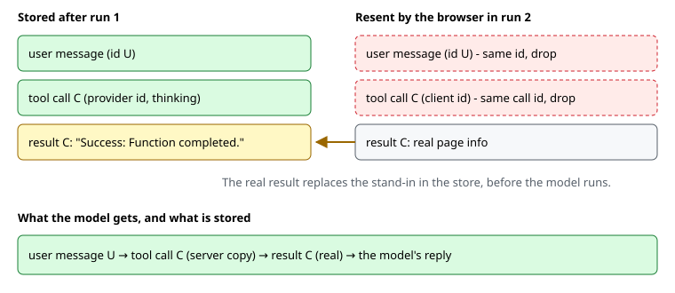

# Architecture: Workspace frontend-tool turn stored once

When the browser resends a turn after a frontend tool, the server recognises it by its user message id and tool call ids. It drops the resent copy, and writes the real tool result over the stored stand-in before the model runs. The same merge repairs old chats the next time they're loaded.



## Decisions
- **Recognise a stand-in result by Microsoft.Extensions.AI's text for a tool that returned nothing**, `"Success: Function completed."` (in `Microsoft.Extensions.AI.dll` 10.7.0), not by a marker of our own. Frontend tools return nothing on purpose (`AIFrontendToolFunction.InvokeCoreAsync`), and old chats already hold that text.
- **Two browser tabs resuming the same chat at the same moment is out of scope.** The merge runs in one transaction, and the later tab finds nothing left to merge.
- **Match the resent turn by the user message id and the tool call ids**, not by message id alone. The browser keeps the user message id but gives the tool call and result messages its own ids (proven from stored rows, see BRIEF). Tool call ids come from the provider and are the same on both sides.
- **Keep the server's stored copy of the user message and tool call**, not the browser's. The server copy has the provider's message id and any thinking content, which Anthropic needs inside a tool loop.
- **Write the real result over the stored stand-in before the model runs**, not after. MAF adds the stored history in front of the request, so the model has to see the real result there. Storing it early is right even if the run then fails: the tool did run.
- **One merge routine, used for new turns and old chats.** It takes a stored history plus the incoming messages and returns what to drop, update and pass on. Old chats run it over their own stored rows, with the repeated block as the "incoming" part.
- **Repair old chats when they're read**: before a run, and when the chat is opened. No migration and no background job.
- **No change to the browser.** It keeps resending the whole turn after a frontend tool (#381).
- **Leave the write-side check (`DropAlreadyPersistedTailAsync`) as it is.** After the read-side merge, nothing resent reaches the store.

## What changes

**Server: `Umbraco.AI.Agent.Copilot.Workspace/src/`**

```text
Umbraco.AI.Agent.Conversations.Core/Conversations/
├── AIResentTurnMerger.cs                 # new, internal: the merge routine (pure, no I/O)
├── ConversationChatHistoryProvider.cs    # drop step uses the merger and writes the real result; repairs old repeats before a run
├── IAIConversationRepository.cs          # new RewriteMessagesAsync: update and delete rows in one transaction
└── AIConversationService.cs              # GetMessagesPagedAsync repairs old repeats before reading
Umbraco.AI.Agent.Conversations.Persistence/Conversations/
└── EFCoreAIConversationRepository.cs     # RewriteMessagesAsync in one EF scope
```

**Tests: `Umbraco.AI.Agent.Copilot.Workspace/tests/`**

```text
Umbraco.AI.Agent.Copilot.Workspace.Tests.Unit/Conversations/
└── AIResentTurnMergerTests.cs            # new: the cases in SPEC's rules
Umbraco.AI.Agent.Copilot.Workspace.Tests.Integration/
└── ...RewriteMessagesTests.cs            # new: RewriteMessagesAsync on SQLite
```

- **Logging:** each merge or repair logs once at information level, with the conversation id and row counts.
- **Transactions:** each repair's updates and deletes happen in one EF scope, so a failure leaves the chat as it was.

Not touched: the browser and Agent.UI (behaviour kept, see Decisions), the AG-UI resume branch for approvals (the browser advances its boundary there), Deploy (conversations aren't deployed), search index (not indexed), migrations (no schema change).

## Data model

No schema change. `umbracoAIConversationsMessage` rows are updated (`ContentJson`, `ContentText`) and deleted by `Id`, in one transaction.

Deleting rows can leave gaps in `Sequence`. That's safe: every use compares or orders by it (`<=`, `>=`, `>`, `OrderBy`), and new rows take max + 1 (checked in `EFCoreAIConversationRepository` and `AIConversationShareReadService`).
