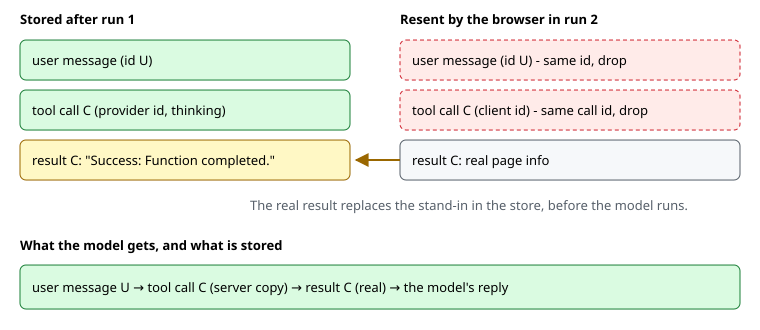

Fixes #751 | [Plan folder](https://github.com/umbraco/Umbraco.AI/tree/b185f877410debfc33f32db2aef2d50dc5aea0cc/docs/plans/workspace-frontend-tool-duplicate-turn)

> [!IMPORTANT]
> **6 choices were made without you.** Please check each one.
>
> **1. Design: the repair reads the repository directly**\
> Plan said: put `RepairRepeatedTurnsAsync` "next to the merger". CLAUDE.md says only an entity's own service reaches its repository.\
> Built: [a new internal singleton, `AIRepeatedTurnRepairer`, that uses `IAIConversationRepository` itself](https://github.com/umbraco/Umbraco.AI/blob/b185f877410debfc33f32db2aef2d50dc5aea0cc/Umbraco.AI.Agent.Copilot.Workspace/src/Umbraco.AI.Agent.Conversations.Core/Conversations/AIRepeatedTurnRepairer.cs#L17). It is only called after the caller's ownership check. The chat history provider and `AIConversationService` already used the repository the same way.
>
> - **A. Keep it as an internal helper** *(recommended)*
> - B. Move the repair into `AIConversationService` and have the provider call the service
>
> **2. Behavior: a failed write during a resent-turn merge fails the run**\
> Plan said: R7 (log and carry on) covers the repair on read only. Nothing about the new-turn merge.\
> Built: [the rewrite is not caught](https://github.com/umbraco/Umbraco.AI/blob/b185f877410debfc33f32db2aef2d50dc5aea0cc/Umbraco.AI.Agent.Copilot.Workspace/src/Umbraco.AI.Agent.Conversations.Core/Conversations/ConversationChatHistoryProvider.cs#L297). The run fails, and the stored chat stays as it was because the write is one transaction.
>
> - **A. Fail the run** *(recommended)*: carrying on would show the model the placeholder result
> - B. Catch, log, and pass the resent turn on unmerged, which brings the duplicate back
>
> **3. Behavior: what counts as a repeated turn in an old chat**\
> Plan said: R6, "a user message whose id appears earlier, followed by calls with call ids that appear earlier".\
> Built: [the calls must appear between the user message's first copy and the repeat](https://github.com/umbraco/Umbraco.AI/blob/b185f877410debfc33f32db2aef2d50dc5aea0cc/Umbraco.AI.Agent.Copilot.Workspace/src/Umbraco.AI.Agent.Conversations.Core/Conversations/AIResentTurnMerger.cs#L113). A repeated user message with no repeated call is left alone.
>
> - **A. Keep the narrow reading** *(recommended)*
> - B. Match calls from anywhere earlier in the chat
>
> **4. Behavior: share recipients still see an old repeat**\
> Plan said: repair on the owner's display read and before a run.\
> Built: [the recipient's read](https://github.com/umbraco/Umbraco.AI/blob/b185f877410debfc33f32db2aef2d50dc5aea0cc/Umbraco.AI.Agent.Copilot.Workspace/src/Umbraco.AI.Agent.Conversations.Core/Conversations/AIConversationShareReadService.cs#L55) goes straight to the store and is not repaired. The repeat goes away once the owner opens or runs the chat.
>
> - **A. Leave it**, so a recipient's read never writes to someone else's chat *(recommended)*
> - B. Repair on the recipient's read too
>
> **5. Behavior: a rewrite does not bump the chat's `Version` or `DateModified`**\
> Plan said: only `ContentJson` and `ContentText` change.\
> Built: [`RewriteMessagesAsync`](https://github.com/umbraco/Umbraco.AI/blob/b185f877410debfc33f32db2aef2d50dc5aea0cc/Umbraco.AI.Agent.Copilot.Workspace/src/Umbraco.AI.Agent.Conversations.Persistence/Conversations/EFCoreAIConversationRepository.cs#L408) leaves the conversation row alone, like `DeleteMessagesFromAsync`. It also ignores ids from another conversation, and deletes an id that is in both lists.
>
> - **A. Don't bump**, so a repair doesn't move the chat up the "Recent" list *(recommended)*
> - B. Bump `Version` and `DateModified` on every rewrite
>
> **6. Behavior: text-only assistant messages in a resent turn pass through**\
> Plan said: R2 drops an assistant message when all of its tool calls are already stored.\
> Built: [a message with no tool calls is passed on](https://github.com/umbraco/Umbraco.AI/blob/b185f877410debfc33f32db2aef2d50dc5aea0cc/Umbraco.AI.Agent.Copilot.Workspace/src/Umbraco.AI.Agent.Conversations.Core/Conversations/AIResentTurnMerger.cs#L183). Today's browser puts text before a call into the same message as the call, so this doesn't happen in the repro.
>
> - **A. Leave it** *(recommended)*
> - B. Also drop a text-only assistant message in a resent turn when its text matches a stored one

## Why the change

After a frontend tool such as `get_page_info`, the browser resends the whole turn, so Workspace stored it twice and kept a placeholder result. This PR stores the turn once with the real result, and cleans up old chats that already hold a repeat.

## How to verify

1. On the v18 demo site, use an Anthropic chat profile and an agent on the `copilot-workspace` surface with the navigation and content scopes.
2. Start a new Workspace chat and ask "Check what page I'm on, then tell me something about it". You should see one question, one `get_page_info` chip and one reply.
3. Read `umbracoAIConversationsMessage` for that chat, ordered by `Sequence`. You should see 4 rows: the user message, the tool call, the real page info (not `Success: Function completed.`) and the reply.
4. Open an old chat that holds a repeated turn (from before this fix). It should show the turn once, and the repeated rows should be gone from the table.
5. Send one more message in that old chat. It should get a reply.
6. In the site log, look for one information line per merge or repair, starting `Conversation <id>:`.

## Good to know

- No migration: rows are updated and deleted in place, which can leave gaps in `Sequence`. Every use orders or compares by it, so gaps are safe.
- Opening a chat now loads all its messages and pages them in memory, because a repeat can span pages. The browser already asks for up to 500 at once.
- One test file outside the Workspace folder changed: `AGUIStreamingServiceTests`, which checks that approval resumes still skip the merge (R10).
- Live-tested on SQLite only. Old chat `d419d8be…` from the issue wasn't in the test database. `2bb58a3c…` (7 → 4 rows) and `cc3f417f…` (27 → 22 rows) were.
- The browser is unchanged. It still resends the whole turn (#381).

## Change outline

How a resent turn is merged into the stored one.



Files, under `Umbraco.AI.Agent.Copilot.Workspace/src/`:

```diff
 Umbraco.AI.Agent.Conversations.Core/Conversations/
+├── AIResentTurnMerger.cs                 # internal, pure: merge a resent turn, find repeats in stored rows
+├── AIStoredMessageMapper.cs              # internal: row <-> ChatMessage, shared by merger and provider
+├── AIRepeatedTurnRepairer.cs             # internal: load, repair, rewrite; logs and carries on if it fails
 ├── ConversationChatHistoryProvider.cs    # #375 drop, then merge + rewrite; repairs before a run
 ├── IAIConversationRepository.cs          # + RewriteMessagesAsync
 ├── AIConversationService.cs              # GetMessagesPagedAsync repairs, then pages the rows
 └── Extensions/UmbracoBuilderExtensions.cs  # registers the repairer
 Umbraco.AI.Agent.Conversations.Persistence/Conversations/
 └── EFCoreAIConversationRepository.cs     # RewriteMessagesAsync in one EF scope
```

Call chain for a run after a frontend tool:

```diff
 StreamConversationAGUIController
 └── AGUIStreamingService (non-resume branch only)
     └── ConversationChatHistoryProvider.DropAlreadyPersistedLeadingMessagesAsync
         ├── drop resent leading run (#375)                     # unchanged
+        ├── AIResentTurnMerger.MergeResentTurn                  # drop resent user/call, keep real result
+        └── IAIConversationRepository.RewriteMessagesAsync      # real result over the placeholder
     └── agent run → ProvideChatHistoryAsync
+        ├── AIRepeatedTurnRepairer.RepairRepeatedTurnsAsync     # old repeats, rows reused
         └── history handed to the model (now holds the real result)
```

Repository contract (internal):

```diff
 internal interface IAIConversationRepository
 {
+    // Updates ContentJson/ContentText by Id and deletes by Id, in one transaction,
+    // only for rows in this conversation. Duplicate update ids throw.
+    Task RewriteMessagesAsync(Guid conversationId, IReadOnlyList<AIMessage> updates,
+        IReadOnlyList<Guid> deleteIds, CancellationToken cancellationToken);
 }
```

<details>
<summary>Checked and fine (7)</summary>

- `AIStoredMessageMapper` is new and not in ARCHITECTURE.md. It is the old private serialize/deserialize/clone code moved out, so the rows the repair writes read back the same way. The reviewer checked the provider change line by line.
- The integration specs use NUnit `[Ignore]`, not xUnit, because that project runs on Umbraco's `UmbracoIntegrationTest`.
- S3 AC3 says "when the delete fails", but EF sends deletes first. The spec makes the update fail after the delete, then checks the delete was undone ([gotcha](https://github.com/umbraco/Umbraco.AI/blob/b185f877410debfc33f32db2aef2d50dc5aea0cc/.claude/memory/ef-atomicity-test-fail-last-statement.md)).
- Merger edge rules: no merge when the stored user message has no id; a tool message with some new results is cut down to the new ones; unreadable rows are skipped; updates are keyed by row id.
- The R10 check (resumes skip the merge) is in the Agent product's `AGUIStreamingServiceTests`, next to `AGUIStreamingService`.
- Creating a snapshot share still calls `GetMessagesPagedAsync` twice. Each call is one load, and the share tests depend on that call pattern.
- Cancellation passes straight through the repair, and a failed load fails the read as before. Only repair and write failures are logged and skipped.

</details>

🤖 Generated with [Claude Code](https://claude.com/claude-code)
