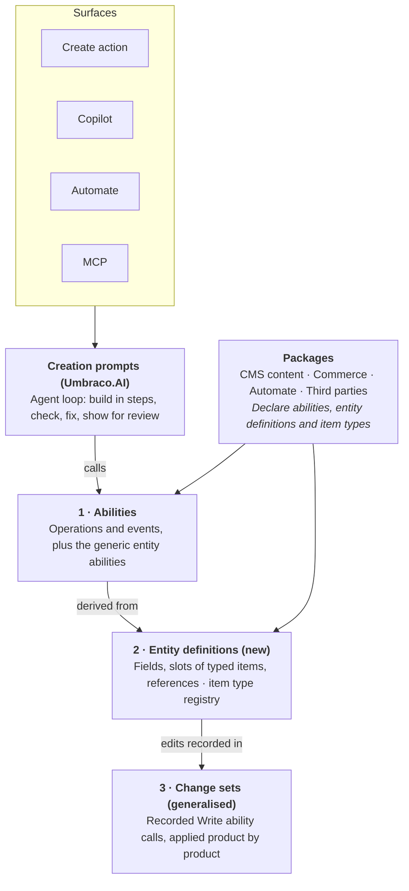

# Abilities, entities and change sets

> **Status:** Draft for discussion. Proven by the proof of concept in
> [`experiments/abilities-poc/`](../../../experiments/abilities-poc/); start with its
> [REVIEWING.md](../../../experiments/abilities-poc/REVIEWING.md) to review the code.

- **Date:** 2026-11-14
- **Authors:** Umbraco AI team
- **Related:** [Draft Sets & Content Validators](../draft-sets-content-validators/BRIEF.md), the CMS Draft Sets vision
  that change sets generalise
- **Source:** exported from the design doc of the same name. This copy is the one in version control; the design doc
  is where comments happen.

## Summary

To create and edit complex entities from text, such as a Commerce discount or an Automate workflow, Abilities needs to describe entities, not only operations. We propose three layers, each owned by a contract that never names a product:

1. **Abilities**: what a package can do (operations) and what happens in it (events). This is the existing Abilities proposal.
2. **Entity definitions**: what a package's entities look like (fields, slots of typed items, references) and how to start, load, check and save one. From this the framework provides generic create, edit, check and find operations.
3. **Change sets**: a record of ability calls held back from the live site, then applied product by product. This generalises the CMS Draft Sets proof of concept from content only to any Write ability.

"Create from text" then needs no per-product code: an agent works on a change set using the generic entity operations, the definition checks the result, and a person reviews and applies it. The same pieces serve copilot editing, content validators, extraction and bulk changes.



*The three layers: what packages declare and what surfaces use.*

Surfaces call abilities; the generic entity abilities are derived from entity definitions, and their edits are recorded in change sets. Packages declare abilities, entity definitions and item types; change sets need nothing extra from them.

Draft for discussion. Commerce and Automate models are described from the domain, not from their code.

## The problem

We want an editor to describe an entity in words ("10% off the Summer collection for VIP customers in December") and get a fully configured entity to review. This should work for any package's entities, on every surface, without a separate integration per product. Four pieces exist today; each stops short.

| What exists | What it does | Where it stops |
| --- | --- | --- |
| Copilot entity tools (`set_value`, `add_item`, `save`) in Umbraco.AI.Agent.Copilot | Stage changes into the open editor through the `uaiEntityAdapter` extension; the user saves | Frontend only, so not available in Automate or MCP. Write tools resolve properties through CMS content types, so a non-CMS adapter fails before it is called |
| Block path engine (`IAIPropertyValueDispatcher`, `IAIPropertyValueHandler`) in Umbraco.AI.Core | Builds nested values step by step on a path `[alias, {blockKey}, alias]`; one engine shared by the copilot and the backend content tools | Finds editors and item types through `IContentTypeService`, so it only works for CMS documents and media |
| [Abilities proposal](https://claude.ai/artifact/NvNZBXiDkbbSKDRPQPKRQJ) | One typed, stateless call exposed as an AI tool, an Automate action and an MCP tool | One call cannot build a rule tree or nested blocks. Approval derived from `Kind = Write` would require approval on every creation step |
| [Draft Sets PoC](https://github.com/mattbrailsford/Umbraco.Cms.DraftSets) | Records content edits instead of saving them, then applies them as one unit | Records `IContentEditingService` calls only (`DraftSetOperationKind`), so other products' changes cannot join a set |

The content block tools also show why complex entities are built in steps: nested values cannot be expressed in strict structured-output schemas, and small steps let each error point at one place.

## Layer 1: abilities

Operations and events stay as the Abilities proposal describes them. This design asks for five additions so the other two layers can sit on top:

1. **A "reversible" fact beside `Kind`.** Recording into a change set, or saving a draft, changes data but can be undone. Approval should follow from Write + not reversible, not from Write alone.
2. **A standard entity reference in outputs.** Inputs already have `[EntityKey]`. Outputs need the same (`entityType`, `unique`, `editUrl`), so one "Open" card and Automate step chaining work for every create and update.
3. **Simplified schemas.** Schemas generated from C# types break on polymorphic or deeply nested inputs in strict structured-output mode. An optional hook gives a simple schema plus an expand step, as `IAISimplifiedPropertyValueTransformer` does today.
4. **Input failures with paths.** Input failures carry the path of each problem, so an LLM can fix the right field and a person can see where it failed.
5. **Callable from a change set.** A Write ability must accept being recorded instead of run. In practice that means it is replayable from its JSON input alone, with no hidden state.

## Layer 2: entity definitions

A package declares each entity type once. The framework derives the generic operations from it, so no package writes `create_discount`, `add_discount_rule` and so on.

### The structure language

Three building blocks, kept deliberately small:

| Building block | Meaning | Examples |
| --- | --- | --- |
| Field | A simple value with a schema | Name, start date, percentage |
| Slot | A collection of typed items; each item's type comes from a registry and has its own settings schema | Discount rules and rewards, blocks in a Block List, Automate steps |
| Reference | A key pointing at another entity, or at another item in the same entity | A product collection; a workflow edge from one step to another |

References between items in the same entity are what let graphs fit: a workflow is a slot of steps whose edges are item references.

**Item types register separately from the entity.** A third-party discount rule provider registers a rule item type, and discounts using it become creatable from text with no more work. Automate step types are abilities, so a workflow is an entity whose slot items are abilities.

### What a package implements

A package describes an **editing contract**: C# classes that say what an AI, Automate or MCP can set on an entity. The contract is not the product's domain model, and nothing goes on the domain model. The definition maps between the two in load and save; the framework derives everything else from the contract.

```
Product domain (e.g. Commerce's DiscountReadOnly, AsWritable, provider settings)
        ↑  LoadModelAsync / SaveModelAsync: the mapping the package writes
Editing contract (DiscountEditModel)
        ↓  derived by the framework
structure, JSON Schema, paths, validation, edit abilities, change sets, rebasing
```

A contract is described in one of two ways, which mean the same thing. Attributes suit a class the package writes for the purpose. Fluent configuration suits a class it doesn't own, such as a Management API request model, and needs no base class.

```csharp
// Attributes, on a class written for the purpose
[Entity("commerce.discount", "Discount")]
public class DiscountEditModel
{
    [Key] public Guid Key { get; set; }
    [EntityName, Required] public string? Name { get; set; }
    [EntityKey("cms.page")] public Guid? LandingPage { get; set; }
    [Slot("commerce.discount.rule", Min = 1)] public List<DiscountRule> Rules { get; set; } = [];
}

// Fluent, over a class the package doesn't own
ModelConfiguration.Configure<MediaRequestModel>(media => media
    .IsEntity("cms.media", "Media")
    .HasKey(x => x.Id)
    .Ignore(x => x.UpdateDate)
    .Field(x => x.Name).IsName().Required()
    .Slot(x => x.Crops, "cms.media.crop"));

// The definition: map to the domain, plus the rules a contract can't express
public class DiscountDefinition : EntityDefinitionBase<DiscountEditModel>
{
    public override Task<DiscountEditModel?> LoadModelAsync(Guid key, CancellationToken ct);  // domain → contract
    public override Task SaveModelAsync(DiscountEditModel model, CancellationToken ct);      // contract → domain
    protected override Task<IReadOnlyList<Problem>> ValidateModelAsync(DiscountEditModel d, CancellationToken ct);
}

// A product ability that edits the entity: works directly, and as a change inside a change set
public class ActivateDiscount : ModelEditAbilityBase<ActivateInput, DiscountEditModel>
{
    protected override Guid KeyOf(ActivateInput input) => input.Discount;
    protected override void Edit(DiscountEditModel d, ActivateInput input) => d.Active = true;
}
```

The framework works out the rest from the contract:

| A package would otherwise write | Now comes from |
| --- | --- |
| Fields, types, required, allowed values, references, slots and limits | Property types, plus attributes or fluent configuration |
| JSON Schema for structured values | `JsonSchemaExporter` over the property type |
| Culture variation | `Varying<T>`, a value per culture, on fields and slots |
| Block settings and grid placement | `[ItemSettings]`/`HasSettings`, `[ItemLayout]`/`HasLayout`, a slot's layout type |
| Turning the contract into the working copy and back | Done both ways, keeping item keys and giving each item its path |
| Range and format checks on entity paths | DataAnnotations, as attributes or fluent `Rule(...)`. Each problem is reported once |
| An edit ability that works inside a change set | One `Edit(model, input)` method |

What the package does write, measured in the proof of concept against a Commerce-shaped domain (immutable entity, UTC dates, rules as provider alias plus string settings):

| Part | Statement lines |
| --- | --- |
| Editing contract and five rule and reward classes | 27 |
| Mapping for the discount: load, save, dates, keys | about 35 |
| Domain rules and item type registration | about 18 |
| Provider settings helper, shared by every Commerce rule and reward type | 22 |

There are two limits:

- **The mapping can't invent ids the domain lacks.** Commerce's rules have none, so keys are derived from the discount, position and provider. They are stable across loads, but a new rule's key changes once saved, and a moved rule reads as removed and added when rebasing. Stable ids on Commerce's rule nodes would fix this.
- **Structure that is data, not code, has no contract class.** A CMS document type is defined in the backoffice, and a workflow's step types are other packages' abilities. These implement `IEntityDefinition` over a typed `EntityDocument`. There is still no JSON digging, and the CMS definition builds Umbraco's own `BlockListValue` and `BlockGridValue`.

**Identity is a UDI**, as in Deploy and the CMS: `umb://document/{key}`. Entity types are UDI entity types (`document`, `media`, `umbraco-commerce-discount`), named after each product's Deploy types, and adding a definition registers its type with `UdiParser`. Change sets and draft sets key what they hold by UDI. Tools still take and return `{ entityType, key }` with a dashed key, because a UDI writes its key without dashes and the same key in two forms invites copy errors. They also accept a UDI wherever they take a reference, store it in the field's own form, and refuse a UDI of the wrong type ("Expected a document, not a media").

Two things surfaced in the proof of concept. Commerce Deploy defines `umbraco-commerce-discount` but doesn't register or deploy discounts today, so the discount definition registers the type itself. And conflict resolutions had been keyed by their own `type:key` string rather than the set's identity; moving to one UDI-based identity exposed and fixed that.

### What the framework derives

- `get_entity_schema`: the structure, fetched in two steps (outline and available item types, then the settings schema of the chosen types) to keep prompts small.
- `create_entity`, `set_entity_value`, `add_entity_item`, `remove_entity_item`, `move_entity_item`: path-based edits, generalised from today's block path engine.
- `validate_entity` and `find_entity` (name to key).

All of them are ordinary abilities, so they reach every surface the way any ability does. CMS documents, media and elements become the first entity definitions, and today's content tools sit on top of them.

## Layer 3: change sets

The Draft Sets PoC already has the right model for change sets: a set is an ordered log of operations, recorded instead of saved and replayed on apply. The change is the recorded unit. Today it is a fixed list of content operations; here it becomes any Write ability call:

Why "change set" rather than "draft set": a set records changes to apply later, across products, and "draft" already means an unpublished version of CMS content. The CMS Draft Sets proof of concept keeps its own name; change sets generalise it.

```csharp
// Today
DraftSetOperation { Kind, ContentKey, ParentKey, PayloadJson }

// Proposed
ChangeSetOperation { AbilityId, InputJson, TargetKey, BaseVersion? }
```

The existing content operations (create, update, move, delete, sort, copy, restore) become the first abilities recorded this way.

| Part | Generic? | Notes |
| --- | --- | --- |
| Recorded unit | Yes | Any Write ability call; the input is already JSON |
| Lifecycle: create, list, apply, discard, the `Umb-Change-Set` header | Yes | Nothing in it is content-specific |
| Atomic apply | Per product | Each product's changes save in its own transaction, one product after another; see "Applying across products" |
| Checking by running and rolling back | Optional per product | Products without Umbraco scopes check through the entity definition's `ValidateAsync` instead |
| Working state of one entity | Yes | `LoadAsync` plus the set's recorded edits applied to the model in memory |
| Reading the whole site inside a set: front-end preview, tree, search | No, stays CMS | Needs the core seams in the PoC's CMS extension proposal |
| Storage | Pluggable | In memory for the PoC; database storage is needed before Automate approvals, which can wait days |

Two things follow:

- **One review across products.** A campaign of new landing pages, a discount and an automation is one set, reviewed together and applied product by product.
- **Approval moves to apply.** Recording into a set is always safe. Only applying the set is a Write that needs approval.

## Applying across products

A change set is atomic per product, not across products. Commerce, Automate and Umbraco.AI can each use their own connection string, so one transaction across products can't be assumed. Each entity definition names its product's unit of work, and applying a set runs in steps:

1. **One step per product**, in the order the set first touched them. All of a product's changes save in that product's own transaction (an Umbraco scope for content, Commerce's unit of work for discounts), so each product applies all or nothing.
2. **Side effects last**, one step each, once every change is applied.

A change set holds two kinds of thing, kept apart:

- **Changes** to entities, which can be reviewed, validated and saved per product. Generic edits are changes, and so is a product ability that changes an entity, provided it says which entity it edits and how. Activating a discount is one: inside a set it is recorded as a change to the discount and shows in its working state; run directly, it saves the discount as before.
- **Side effects**, such as sending an email: any other Write ability. They change nothing that can be reviewed or undone, so they are listed separately as "after apply" and run only once every change is applied. A failed side effect has nothing to roll back.

If a step fails, it rolls back and the steps before it stay applied. The set is kept, with its applied products locked; the rest can be fixed, and applying again resumes at the failed step without applying anything twice. Before approving, the person sees the plan: which products apply, each all or nothing, then which side effects run afterwards.

Products that do share a database could apply in one transaction as a bonus, but nothing depends on it. The proof of concept shows this against real Umbraco: a refused save rolls back the content saved before it in the same scope, and a failed side effect after the content leaves the content applied and the set resumable.

## Rebasing onto changes saved elsewhere

When someone saves an entity a change set is editing, the set rebases onto the newer version instead of being refused. This works because a set records edits by path, not copies of entities: its edits are replayed onto the live version.

1. The first time a set edits an existing entity, it remembers the version it started from. If the product keeps version history, that is just the version number, and the version is loaded from the history when needed. Otherwise the set keeps a snapshot.
2. What someone else changed is the difference between that starting version and the live one. What the set changed is the difference between the starting version and the set's result. One generic diff does both, for every product.
3. Changes that don't overlap rebase automatically, and the summary lists what changed meanwhile.
4. A value both changed differently, or an edit inside an item the other removed, is a conflict. Validation shows both values, apply waits, and the person or agent keeps yours or theirs per path. Edits to an item someone else removed can only keep theirs.
5. The same change on both sides isn't a conflict. If the starting version is gone from the product's history (a version clean-up), the entity can't be rebased and validation says why.

The proof of concept shows this against real Umbraco: a Danish subtitle changed in the backoffice is kept while the set's English block edit applies on top, and a subtitle both changed is a conflict with its culture until one is kept. The CMS definition still uses a snapshot: whether every draft save gets a new version that stays in the history needs checking before it can rely on the history.

## What the CMS already gives us

The framework uses CMS features wherever one fits, and builds only what the CMS lacks. The proof of concept checked each part:

| Need | Uses | Status |
| --- | --- | --- |
| Entity identity | UDIs | Used |
| What a value varies by | `ContentVariation` | Used; replaced an identical enum of our own |
| Block editor values | `BlockListValue`, `BlockGridValue`, `BlockItemData` | Used |
| A transaction for content | Umbraco scopes | Used, behind a unit of work that other products implement with their own connections |
| Packages reacting to, or vetoing, an apply | CMS notifications | Used: a cancelable applying notification for change sets and draft sets, like `ContentSavingNotification`, then applied and discarded |
| Who applied what | The audit log | Used for documents |
| The version a set started from | Content versions | Not usable: a save updates the current version in place, and only publishing creates one. Tested against Umbraco 18 |
| References between entities of different products | Relations and tracked references | Not usable: a relation joins two CMS nodes, so a Commerce discount can't take part |
| An audit entry for a non-CMS entity | The audit log | Partly: its object id is a CMS node, so a Commerce entity is logged with no node and its UDI in the comment |

Also used, after a second pass:

| Need | Uses | Status |
| --- | --- | --- |
| Work after a transaction commits | Scopes: notifications published through the scope, and enlisted scope-exit actions | Used. Both run only when the outermost scope commits, so a draft set applied inside a scope that rolls back is neither marked applied nor announced |
| Who may do what | The CMS's permission model (`IContentPermissionService`) | Used. See Authorization below |
| Side effects that need retries | `IBackgroundTaskQueue`, processed by `QueuedHostedService`, with Polly | Used. Webhooks weren't, as they're going away. See Retries below |
| Results and problems | `Attempt<TResult, TStatus>` and `PropertyValidationError` | Mirrored: a result has a status (Success, InvalidInput, AccessDenied, Failed) and a result; a problem has error messages, culture and segment |

Left for later: **storage**. Change sets and draft sets are held in memory, which doesn't work across load-balanced servers.

### Authorization

An agent acts for a user and gets that user's permissions, no more. Abilities never build their own permission model: a definition asks its product whether a user may read, create or update an entity, in the cultures a change touches.

| When | Who is checked |
| --- | --- |
| An edit is recorded | The user making it |
| A set is applied | The user applying it, for every change, before validating. If any change is refused, nothing is applied |
| Entities are found or read | The user: find shows only what they may read, and a read is refused |
| A product ability runs directly | The user, the same as inside a set |

For content, the CMS decides: the Content section, the document permission on the document (or, for a new one, its parent or the root), and access to the cultures touched. A refusal is not correctable, so an agent should stop and tell the user. The user applying is checked again because they may not be who made the changes, and permissions can change while a set is open.

### Retries

A side effect that may fail for a while declares how many retries it allows. Applied in a change set, it runs on Umbraco's background task queue once every change is applied, retried with Polly: exponential backoff with jitter, for failures only, never correctable input or a refusal. Polly.Core 8.5.0 is the version an Umbraco 18 site already resolves, so this adds no new dependency. The outcome is a notification, since the set is applied by then.

The queue is in memory, so work still queued when a site restarts is lost. Durable side effects need stored work, which belongs with storage.

## CMS Draft Sets as a participant

The CMS can build Draft Sets for content on its own, with no dependency on Abilities, and a change set uses it as one participant. A product that keeps its own drafts implements `IDraftingEntityDefinition`. The change set then holds one of that product's drafts and hands it the product's changes, instead of keeping and replaying them itself.

```
Change set (Abilities)
├── Content step  → a CMS draft set  (CMS only: no Abilities reference)
├── Commerce step → the change set's own recorded changes, replayed
└── Side effects  → email.send, …
```

The draft set is the source of truth for content. Changes an AI makes are a CMS draft set that the backoffice can review and preview. The change set keeps only the draft set's id. Products without drafts of their own work as before, and both kinds mix in one set.

| The change set needs to | The CMS draft set provides |
| --- | --- |
| Record an edit | New content staged whole; existing content as only the property values, per culture and segment, the edit changed |
| Read the working state | Live content with the set's changes over it, in editor format |
| Rebase and find conflicts | What others changed since the first change, and the values both changed |
| Resolve a conflict | Keep the draft's value or the live one |
| Apply its step | Every document in one scope, all or nothing |
| Discard | Throw the draft set away |

Recording per-property changes over live content makes rebasing automatic: someone else's change to another property is simply kept.

The proof of concept builds this against Umbraco 18. A stand-in for the CMS feature references Umbraco only, and the CMS document definition adapts it. All the real-Umbraco tests pass through it. A test also uses the draft set on its own, the way the backoffice would, with no abilities at all. It found two things:

- **A one-language document failed validation and save** on a mandatory property in its other language. Update validation checks every culture unless told which ones, and save reports problems in every culture while still saving. Validating only the document's own cultures fixed it. The same bug was in the earlier CMS definition, hidden because every test page existed in both languages.
- **Conflicts are coarser than the generic diff.** A block property is one value, so two people editing different blocks in the same Block List conflict. Merging at block level needs block-level change tracking in the draft set.

## If core owned the change set

CMS core's Draft Sets could itself become the change set. Every product already depends on CMS core but not on Abilities, so a coordinator in core would reach all of them. It would also give one backoffice place to review everything a set will change, whoever made the changes.

```
CMS core: Draft Sets = the change set
├── coordinator: one step per product, all or nothing per product, resumable, rebase and conflicts
├── public participant contract (today's IDraftingEntityDefinition seam)
├── content participant, built by the CMS team
└── Commerce, Forms, … implement their own participant

Abilities, on top
├── structure, paths, generic edit tools, item types
├── records ability calls by staging them into a draft set
└── side effects after apply, and approval
```

**Decision for now:** the proof of concept keeps the coordinator in Abilities, because that lets us move faster. Moving it into core later needs no change to the participant contract, as long as core's Draft Sets is built with the points below in mind.

### What core's Draft Sets must address to become the generic change set

| # | Core must | Why |
| --- | --- | --- |
| 1 | Address entities by UDI (umb://document/{key}), even if v1 does only documents | Media created in the same set, then other products' entities, without a redesign |
| 2 | Record per-property changes (alias, culture, segment) over a base, not whole update models | An update model replaces every value, so it can only overwrite or refuse; per-property changes can rebase |
| 3 | Keep a base version and base values per entity from its first change. Content versions can't serve: a save updates the current version in place, and only publishing creates one | To show what others changed since, and find conflicts |
| 4 | Report conflicts in a neutral form: entity, property alias, culture, segment, and base, draft and live values | So a coordinator, the backoffice or an agent can show and resolve them |
| 5 | Let the caller choose keys for new content | So other changes in the set can refer to content before it exists |
| 6 | Make reads draft-aware: get by key, and find, through a draft set | So whoever builds the set sees their own changes |
| 7 | Validate a whole set, per entity, only in the cultures each document has | Before anyone approves it, and without failing languages a document doesn't exist in |
| 8 | Apply all or nothing in one scope, record that it applied, and refuse to apply twice | A coordinator applies products one after another and resumes after a failure |
| 9 | Raise CMS notifications: a cancelable applying, then applied and discarded (the proof of concept does this) | Audit, caches and other packages hook in |
| 10 | Make a draft set's id, create, apply and discard public, assuming nothing about who started it | A coordinator, the backoffice or Automate can drive it |
| 11 | Shape the coordinator and participant contract generically from day one, with content as the first participant | Going from content-only to the generic change set is then adding participants, not redesigning |
| 12 | Leave side effects, approval and the AI-facing structure language out of core | Core has no "operation to run afterwards", approval is per caller, and the structure language is a large, fast-moving API |

Recommended but not required: block-level change tracking inside block properties, so edits to different blocks don't conflict. Also capturing `IContentEditingService` calls into an ambient draft set, as the original Draft Sets PoC does, so existing code is drafted without a new API. Any of this in core goes through the CMS contribution and RFC process.

## Creation prompts end to end

Creation prompts are a feature of Umbraco.AI built on the three layers, not part of any contract. Every entity type with a definition gets them automatically.

1. The person gives an entity type and a description. A change set is started, or the active one is used.
2. An agent gets the generic entity abilities for that type, plus read abilities for resolving names ("Summer collection" to a key).
3. The agent fetches the structure, then builds the entity step by step. Each step is recorded in the change set.
4. After each step, `ValidateAsync` returns problems by path; the agent fixes them.
5. The result is shown with a summary and the assumptions the agent made.
6. The person opens it in the editor, asks for changes, or applies the set.

| Surface | How it starts | How it ends |
| --- | --- | --- |
| Backoffice "Create with AI" action | Entity action on any entity type with a definition | Opens the editor showing the set's working state |
| Copilot | Chat on a create screen or anywhere in the backoffice | Same; follow-up messages ("make it 15%") are more edits in the set |
| Automate | Generic action "Create {entity} from text", fed by earlier steps | The set waits for approval in Automate's existing approval flow, then is applied |
| MCP | The derived abilities, with the `Umb-Change-Set` header | The client applies the set, or leaves it for a person |

The editor needs to load a set's working state into a create or edit screen. For CMS content the PoC's read overlay does this. Other products need a way to open their editor with a given model; this is not yet checked for Commerce or Automate.

## Checked against future ideas

Each idea below uses the same three layers with no new contract.

| Idea | Abilities | Entity definitions | Change sets |
| --- | --- | --- | --- |
| Creation prompts | Generic entity abilities | Structure, new, check, save | Holds the steps until applied |
| Copilot editing ("make it 15%") | Same edit abilities | Load an existing entity | Edits recorded, the editor shows them |
| Content validators | A validator is an ability | `ValidateAsync` problems by path | Validate a whole set before apply |
| Extraction (email to order or discount) | The Extraction capability as an ability | The structure is the extraction schema | The extracted entity waits for review |
| Bulk changes: translate, import a CSV | A loop of edit abilities | Load and save | One reviewable set for all items |
| Summaries and diffs for approval | — | Structure plus paths describe each change | The set is the list of changes |
| Cross-product campaigns | Write abilities from several products | One definition per entity type | One set, applied together |

## Hard problems and risks

| Problem | Why it matters | Possible answer |
| --- | --- | --- |
| New items referring to each other | A discount refers to a page created in the same set | Keys chosen by the caller (CMS create models already accept a key), or key remapping during apply |
| Products outside Umbraco's transaction | All-or-nothing apply across products breaks | Settled: apply per product, each all or nothing, resumable across products (see "Applying across products") |
| Live data changing under an open set | Applying a stale set overwrites newer work | Settled: rebase onto the live version; only overlapping changes are conflicts to resolve (see "Rebasing onto changes saved elsewhere") |
| Scope creep | Abilities turns into an entity framework, or the structure language turns into a CMS data model | Keep the structure language to fields, slots and references |
| Cost for products | Teams will not describe their models if it is laborious | Typed models with attributes; the structure derived from C# types where possible |
| CMS content duplicated | Documents already have drafts and the path engine | CMS content becomes the first entity definition, not a parallel system |
| Ownership | Draft Sets is pitched as a CMS core feature; a generic recorded unit makes core depend on the Abilities contract | Match the PoC's operation shape to an ability call now, so moving into core later is a rename |
| The contract can only grow | A wrong early choice becomes permanent | A longer pilot for entities and change sets than for operations and events |

## Proof of concept findings

A standalone [proof of concept](../../../experiments/abilities-poc/) implements all three layers, with stand-ins for a CMS page with nested blocks, a Commerce discount, a third-party rule type and an Automate workflow. Its 13 tests drive everything through the generated AI tools with scripted calls; no real model and no real product code are involved. It surfaced four changes to this design:

| Finding | What it showed | Change to the design |
| --- | --- | --- |
| Approval depends on the call, not just the tool | `email.send` needs approval when run directly, but inside a change set it is only recorded. M.E.AI's `ApprovalRequiredAIFunction` wraps a tool once, so it cannot express "only outside a set" | Decide approval per call from the context, and put it on applying the set |
| Side effects are not checked when recorded | An email with an invalid recipient was accepted into the set and only failed at apply | Add an optional "check this input without running it" hook to abilities, so a whole set can be checked before anyone approves it |
| Every read must see the set's changes | Finding an entity by name inside a set first missed one renamed in the set. The generic reads now use the working state, but a product's own Read ability still shows live data | The framework needs a way to show a set's changes to product Read abilities: the generic form of the CMS Draft Sets read overlay |
| Keys chosen at record time work | Writing generated keys into the recorded input made replay deterministic. A discount referred to a page created in the same set, and a workflow step to a later step, with no key remapping | Settles the "new items referring to each other" risk in favour of keys chosen when the call is recorded |
| Typing moves the work, not the line count | Moving the samples to model classes left their size about the same: Commerce went from 74 to 62 statement lines, and the real CMS definition from 621 to 599 lines. But a discount's structure was previously written twice, as field definitions and as string-keyed JSON reads. Now it is written once. Typed values also exposed a validator bug that only parsed JSON had hidden | Make EntityDefinitionBase\<TModel> the default for package developers, with IEntityDefinition over a typed document as the escape hatch for structure that is data |

Not yet proven: real CMS documents (cultures and segments are not in the structure language yet), the real Commerce and Automate models, persistence, permission checks, and opening a set in an editor.

## Checked against the real models

The structure language holds up against the real CMS, Commerce and Automate code, with five additions for CMS content and one for Automate. Three gaps can only be closed in the products themselves. Sources: Umbraco CMS `main` (18.5.0-rc), Umbraco.Commerce `dev` and Umbraco.Automate `v18/dev`, read on 13-11-2026. The proof of concept's CMS sample now follows the real content model's shapes, and its 20 tests pass.

### Additions to the structure language

| Addition | Needed by |
| --- | --- |
| Variations on the entity, fields and slots (named after the CMS's Variations and ContentVariation): values stored per culture and segment, edits take a culture, problems say which culture | CMS: names and properties vary by culture or segment; blocks in an invariant block property hold per-culture values |
| Culture-variant slots: a separate item list per culture | CMS: a culture-variant block property holds one whole value per culture |
| A settings element per item, edited at `{item}/@settings` | CMS: blocks have a settings element type beside their content type |
| Placement values per item, edited at `{item}/@layout` | CMS: a Block Grid block's column and row span belong to its place, not its values |
| Arrays, references to several entity types, and JSON values | CMS: tags, tree pickers pointing at documents or media, focal points and crops |
| Edges as a first-class part of an entity, carrying their own data | Automate: steps are a flat list and edges are a separate list with an outcome, handle and filter; loops and parallel paths come from edges, not nesting |

Commerce discounts need no additions. Their rules are one recursive tree under a group rule (AND/OR is a setting), which fits as a single-item slot with nested slots. The definition must give rule and reward nodes keys when it loads them, since Commerce stores none.

### Gaps the contract cannot close

| Gap | Product | Consequence |
| --- | --- | --- |
| Saves can't join an Umbraco scope: Commerce uses its own unit of work and database connection | Commerce | Not a blocker: change sets apply per product, so they don't need Commerce to join (see "Applying across products") |
| No usable concurrency check: Commerce's `Version` isn't exposed and conflicts are retried; the CMS has no token on update | Commerce, CMS | Rebasing works without one, by diffing against the version the set started from (a snapshot when there's no history). Not caught: a change saved between validating and saving. For content, compare `UpdateDate` or `VersionId` inside the apply scope |
| Validation without paths: Commerce and Automate return message-only errors, and Commerce doesn't validate rule settings at all | Commerce, Automate | Each entity definition has to produce problems by path itself |

Smaller points for the CMS definition: blocks in rich text are placed by markup, so adding one needs an anchor; segments aren't managed, so they can't be listed; an update replaces every property, and invalid values are saved with errors returned, so the definition sends the full working copy and treats returned errors as a failed apply.

Two existing Umbraco.AI defects turned up and were raised: [#746](https://github.com/umbraco/Umbraco.AI/issues/746) (Multi URL Picker links saved without a target) and [#747](https://github.com/umbraco/Umbraco.AI/issues/747) (block settings created with the content element type). Umbraco.Commerce.AI is read-only today; its backlog already plans the same flow for discounts: create an inactive draft from a description, check it against the rule and reward providers, and show a summary to confirm.

## Proven against a real Umbraco

A real definition for CMS documents now runs against Umbraco 18 on SQLite, and all 6 of its integration tests pass. It builds the structure from document types and their Block List and Block Grid data types, and loads and saves through `IContentEditingService` inside one Umbraco scope. It validates with Umbraco's own validation.

The tests show:

- A culture-variant page with per-culture block values, a block settings element, grid column spans and grid areas, built through the AI tools, is stored by Umbraco as expected and loads back to the same shape.
- Editing an existing page keeps everything the edit didn't touch.
- A failure during apply rolls back a page already saved in the same scope.
- Apply is refused when the page was saved in Umbraco after being edited in the set.

It changed the design in two ways:

| Finding | Change |
| --- | --- |
| Documents are one entity type with a structure per document type, chosen at create | Entity definitions can have **subtypes**: the schema and create take a subtype. Media and member types will need the same |
| Umbraco only treats a block as part of the cultures it has values in, and doesn't validate it elsewhere | The generic validator follows the same rule, so an English-only block isn't reported as missing its Danish values |

It also confirmed two smaller points. Umbraco reports errors inside a block with the culture in a JSON path filter, counting only the blocks shown in that culture, and the definition maps these back to entity paths. Umbraco saves invalid values and reports them afterwards, so the definition treats any reported error as a failed save, which rolls the scope back.

Not covered yet: templates, publishing, rich text with blocks, segments inside blocks, a parent created in the same set, and permissions (the tests run as the super user).

## Beyond this spec: Deploy

Entity definitions could also give add-on products Deploy support for free. Abilities themselves don't help: Deploy moves state between environments rather than invoking actions. But a Deploy connector does mostly what an entity definition already describes. Umbraco.AI's own Deploy package is about 1,800 lines of hand-written connectors and artifacts for 7 entity types, and each connector repeats the same jobs:

| What a connector does (e.g. `UmbracoAIProfileServiceConnector`) | Already in an entity definition |
| --- | --- |
| Get an entity by key, list them, give its name | `LoadAsync`, `ToRef`; listing every entity of a type would need adding |
| Serialise it to an artifact | The entity document is already a product-neutral JSON form |
| Declare dependencies, e.g. a profile on its connection, contexts and guardrails | References are declared in the structure, including inside items, so they can be found by walking the document |
| Restore it on the target with the same key | `SaveAsync` with the same key; keys are stable GUIDs |
| Deploy in passes so dependencies come first | Can be worked out from the reference graph instead of hard-coded pass numbers |
| Notice what changed | The generic diff, or a checksum of the entity document |
| Identify the entity and its references by UDI | Entity types are UDI entity types and identity is a GuidUdi, so a connector's UDI type is the definition's entity type, with no mapping |

A generic connector derived from entity definitions would need four additions to the contract:

- **Sensitive values** that never leave the environment, such as API keys. Today `UmbracoAISensitiveSettingsFilter` strips them by hand; a field-level marker would do it generically.
- **Environment-specific references** that should be matched on the target rather than copied, like Deploy's dependency modes.
- **Schema dependencies:** an entity depends on its subtype, e.g. a document on its document type.
- **Listing all entities of a type**, for "deploy everything" selections.

This is for add-on products (Commerce, Forms, Automate, Umbraco.AI itself), not CMS content, which Deploy already supports fully. It's based on Umbraco.AI's connectors only, not Deploy's own APIs in depth. A cheap proof: derive a connector for one Umbraco.AI entity type, such as profiles, and compare it with the hand-written one, including its passes and sensitive-settings handling.

A looser link, kept as an idea for now: a change set is a reviewed group of changes, which is close to what a selective deploy transfers.

## Next steps and decisions

The cheapest proof is in the Draft Sets PoC, before the Abilities contract exists.

1. **Generalise the PoC's recorded unit.** Change `DraftSetOperation` to `{ AbilityId, InputJson, TargetKey, BaseVersion? }` with the existing content operations as the first implementations. If content loses nothing, the layering holds.
2. **Write CMS documents as an entity definition (done in the proof of concept).** Move the block path engine's three CMS lookups (top-level editor, nested item type, load and save) behind the definition. Today's content tools should keep working on top of it.
3. **Pilot one non-CMS entity.** A Commerce discount tests slots with registered item types; an Automate workflow tests references between items. Both need a look at the real models first.
4. **Build creation prompts on the pilot.** Backoffice action and copilot first, Automate once change sets are stored in the database.

Decisions:

- [ ] Are entity definitions and change sets part of Abilities v1, or a planned second step that the v1 contract leaves room for?
- [ ] Where are change sets stored: memory only, or the database from the start?
- [ ] Who owns change sets once they are generic: the CMS team, the AI team or the Abilities owner?
- [ ] Which non-CMS entity pilots first: a Commerce discount or an Automate workflow?

## Sources

- [Umbraco Abilities: write once, available everywhere](https://claude.ai/artifact/NvNZBXiDkbbSKDRPQPKRQJ) (the Abilities proposal)
- [Umbraco.Cms.DraftSets PoC](https://github.com/mattbrailsford/Umbraco.Cms.DraftSets): `DraftSetOperation`, `DraftSetReplayer`, `IDraftSetStore`, `docs/cms-extension-proposal.md`
- [Umbraco.AI repository](https://github.com/umbraco/Umbraco.AI):
  - Content tools: `Umbraco.AI/src/Umbraco.AI.Core/Tools/Umbraco/` (`CreateUmbracoContentTool`, `AddUmbracoContentItemTool`, `ContentPropertyValueOperationHelper`)
  - Path engine: `Umbraco.AI/src/Umbraco.AI.Core/PropertyValueOperations/` (`AIPropertyValueDispatcher`, `IAIPropertyValueHandler`, `IAISimplifiedPropertyValueTransformer`)
  - Entity adapters: `Umbraco.AI/src/Umbraco.AI.Web.StaticAssets/Client/src/entity-adapter/`
  - Copilot tools: `Umbraco.AI.Agent.Copilot/src/Umbraco.AI.Agent.Copilot/Client/src/copilot/tools/entity/`
  - Automate action: `Umbraco.AI.Automate/src/Umbraco.AI.Automate/Actions/RunAgentAction.cs`
  - Related plans: `docs/plans/draft-sets-content-validators/BRIEF.md`, `docs/plans/hitl-approval/BRIEF.md`

* [Umbraco CMS](https://github.com/umbraco/Umbraco-CMS) (`main`): `ContentCreateModel`, `ContentUpdateModel`, `ContentEditingServiceBase`, `BlockValue`, `BlockGridConfiguration`, `PropertyValidationError`
* [Umbraco.Commerce](https://github.com/umbraco/Umbraco.Commerce) (`dev`): `Discount`, `DiscountRuleConfig`, `GroupDiscountRuleProvider`, `UmbracoCommerceUnitOfWorkProvider`
* [Umbraco.Automate](https://github.com/umbraco/Umbraco.Automate) (`v18/dev`): `Automation`, `StepConfiguration`, `StepConnection`, `AutomationService`, `AmbientDbContextFactory`
* [Umbraco.Commerce.AI](https://github.com/umbraco/Umbraco.Commerce.AI) (`main`): read-only tools, `backlog/mcp-poc-learnings.md`

- Umbraco.AI Deploy connectors: `Umbraco.AI.Deploy/src/Umbraco.AI.Deploy/Connectors/ServiceConnectors/` (`UmbracoAIProfileServiceConnector`, `UmbracoAISensitiveSettingsFilter`, `UmbracoAIProfileDependentEntityServiceConnectorBase`)
