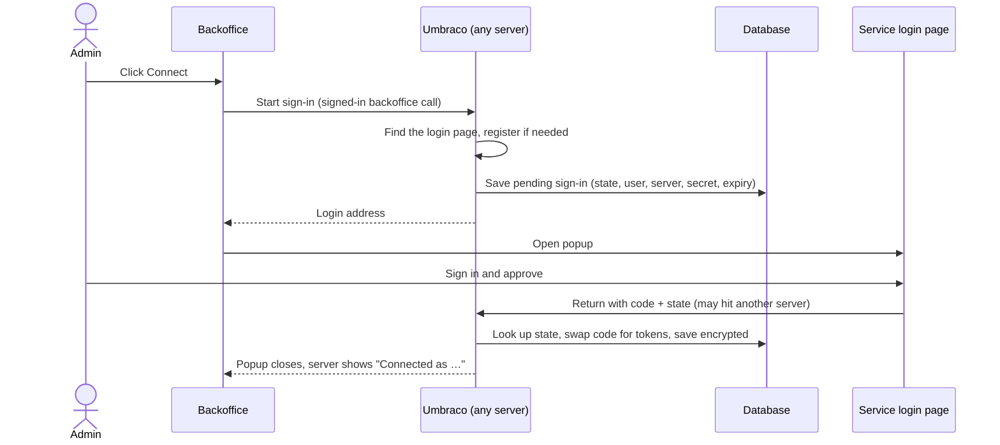
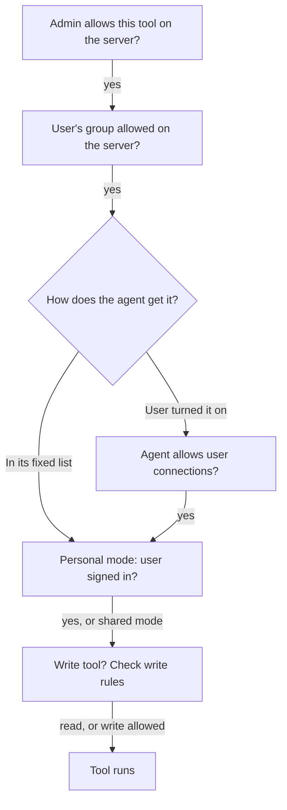

# Feasibility: Copilot as MCP client

> **Status:** Feasibility study. First pass 21-10-2026, decisions and review added 11-11-2026,
> checked against `v18/dev`. Source idea: "Copilot as MCP client: external context for
> Umbraco.AI" (Claude Doc by Filip Bruun Bech-Larsen, 20-10-2026). Not a design. Sections
> touching personal data are an AI-assisted draft, pending legal/compliance review. Dated
> decisions and review findings: [DECISION-LOG.md](DECISION-LOG.md).

**Feasible, but bigger than it looks.** Copilot can call outside tools today, but the parts that
make it safe and usable do not exist yet: a list of approved servers, our own sign-in flow, a
tool source that works on every route, enforced read-only, and per-call audit.

> [!IMPORTANT]
> **6 questions need the team.**
>
> 1. Which two servers do we prove it with? We need ones that speak Streamable HTTP. Whether
>    they allow automatic client registration decides if admins must paste a client ID.\
>    _If not decided:_ phase 1 can't be scoped or tested against anything real.
> 2. The server list lives in `Umbraco.AI.Agent` (so the sidebar, Workspace and Automate can all
>    use it).\
>    _If not:_ Copilot Workspace owns it, and Automate and the sidebar lose access.
> 3. Approve adding `ModelContextProtocol` (latest stable 2.4.0). It raises the minimum
>    `Microsoft.Extensions.AI.Abstractions` to 10.11.0 and other `Microsoft.Extensions.*`
>    packages to 10.0.14 on both lines (we declare 10.7.0 and 10.0.9 today).\
>    _If not:_ we write our own MCP client.
> 4. Legal/DPA review of sending outside personal data (CRM records) to AI providers. Phase 1
>    already does this through a shared account.\
>    _If not done:_ phase 1 can't ship.
> 5. In Workspace, outside text will sit next to Umbraco write tools (create/update content).
>    Workspace does not block destructive backend tools today. Keep it that way, relying on
>    approval prompts?\
>    _If not:_ Workspace needs the same lock as the sidebar, or a narrower one.
> 6. "A colleague continues a shared conversation, fetching as themselves": fork, multi-writer,
>    or drop it? The 21-10 update says share-conversations will grow multi-writer, but it isn't
>    decided.\
>    _If not decided:_ the acting-user work (see Collaboration) has no target.

**Terms used here.** A _server_ is an MCP server an admin added to Umbraco. A _sign-in_ is a
stored token for a server. "Connections" in the UI wording below means servers a user turned on.
None of this is the existing Umbraco.AI **Connections** entity (provider API keys).

## How it works

### Servers and sign-in

- **One kind of server: remote MCP over Streamable HTTP.** No per-service code like Automate's
  Slack handlers. MCP servers publish where to sign in, so one flow fits all. Local (stdio)
  servers would mean launching processes on the web server, which can't work on Umbraco Cloud.
- **OAuth is in phase 1.** Many hosted servers (HubSpot, Notion and others) only accept OAuth. A
  static API key or bearer token stays as an option for servers that offer one.
- **Two sign-in modes per server:**
    - **Shared account** (phase 1). An admin signs in once. Every allowed editor sees whatever that
      account can see. We should advise a dedicated service account, not a person's login.
    - **Each user signs in** (phase 2). Each editor uses their own account and sees only what it
      can see.
- **The admin's server list is the only way in.** Each server has a name, URL, sign-in mode,
  allowed tools (each flagged read or write) and allowed user groups. Editors can't add an
  address of their own.
- **User group access is checked on the server,** never just hidden in the UI. The tool source
  leaves out servers the user's groups don't allow, and the Connect endpoint refuses them.

### We run the sign-in ourselves

The MCP library's own sign-in only finishes inside the request that started it: it keeps the
secret parts in memory and swaps the login code for a token itself. On Umbraco Cloud the login
can come back to a different server, or after a restart, and be lost. So we run the browser
login ourselves and hand the tokens to the library.

- **The return page is anonymous** (a browser redirect carries no backoffice login). It trusts
  only what the pending row says. That row was created by a signed-in admin or editor, and it
  ties the result to that user and server.
- **The library then uses the tokens.** Our token store gives it the stored token plus the
  registered client ID, so it never registers again. One MCP client per user per server, never
  shared.
- **One refresh at a time.** Many editors share one token across several web servers. If two
  refresh at once, the service may cancel both and the server flips to "Needs reconnecting" for
  everyone. Refresh runs under a database lock. Automate's refresh code has no lock, so copy its
  shape, not that part. How the library's own refresh goes through the same lock is a design
  question.
- **Tokens are tied to the server's URL.** Each token row stores the URL and issuer. Editing the
  URL marks the server "Needs reconnecting", so an old token is never sent to a new host.
- **Secrets are never sent back to the browser.** Pasted client secrets and static tokens are
  write-only from day one. Don't copy the Connections API, which returns decrypted values and
  only hides them on screen.
- **Worth copying from Automate** (`Umbraco.Automate.OpenIddict`): credentials in their own table
  that the server points to by ID, and the cleanup job for sign-ins that were started but never
  finished.

### Personal sign-in (phase 2)

- **Where editors connect.** Inline in chat when needed: Copilot leaves out that server's tools,
  says "Connect HubSpot to use this", and shows a Connect button. A "My connections" panel in the
  user profile is also possible (the CMS lets packages add a user profile app, as Theme and
  History do). Design confirms whether the popup works from there.
- **Admin oversight.** The admin sees who has connected and can disconnect anyone.
- **Cleanup.** A user's tokens go when the user is deleted or disabled. All tokens for a server
  go when the server is removed.
- **Acting user.** Calls run as the person who sent the message, not the conversation owner. The
  run only knows the owner today (`UserKey`).
- **Background runs.** Automate and scheduled agents have no editor present, so they use shared
  servers only.

### Which servers a run gets

Servers are not global. One CRM server can add 50+ tools, and each server is another way for
outside text to steer the model. This follows what users know from Claude and ChatGPT: an admin
turns a service on (optionally per group), each person connects their own account, and they pick
connections per chat, while a purpose-built agent can be locked to a fixed set.

**Agent settings** (on the agent's Tools tab):

- **Always use these servers.** On for every chat with this agent. The agent's existing
  per-group overrides apply ("Writers don't get HubSpot on this agent").
- **Let users add their own connections.** Yes or no, **default No**, so a new agent never
  quietly accepts outside data.

**Example agents:**

- **Campaign helper:** HubSpot and Analytics fixed, users can't add.
- **General Copilot:** nothing fixed, users can add.
- **Content publisher:** nothing fixed, users can't add. It edits content, so it stays sealed
  off from outside text.

**User choice** (phase 2): editors turn servers on per conversation, or per project in Workspace.
Only servers their groups allow are offered. A project doesn't narrow the agent; it says "this
project uses HubSpot" for that user's chats.

**Auto agent pick.** Copilot often picks the agent itself, so a user could turn on HubSpot and
get an agent that can't use it. Two fixes, together:

- **Filter before picking.** When the user turned servers on, only agents that accept user
  connections are candidates. This can't be a new step in the `IAIAgentSelector` chain: each
  step returns one agent or nothing, and the candidate list is fixed before the chain runs. It
  needs a change to candidate selection, a field for the user's servers on the selection request,
  and Workspace loading those servers before it picks.
- **Never ignore a server silently.** If the chosen agent can't use one, the chat says so
  ("HubSpot isn't available to the Content publisher agent").

The fixed list has the same gap (the picker may never choose the Campaign helper), but that is
how auto pick already treats every agent setting.

### Where each part works

|                       | Sidebar      | Workspace                    | Automate |
| --------------------- | ------------ | ---------------------------- | -------- |
| Fixed servers         | Yes          | Yes                          | Yes      |
| User-added            | Per chat     | Per chat or project          | No       |
| Shared sign-in        | Yes          | Yes                          | Yes      |
| Personal sign-in      | Yes          | Yes                          | No       |
| Read tools            | Yes          | Yes                          | Yes      |
| Write tools (phase 2) | **No**       | Personal only, with approval | No       |
| Source labels         | Live in chat | Live and saved               | Run log  |

Automate has only shared servers, and writes need personal sign-in, so Automate gets no MCP
writes.

### Write tools (phase 2)

- **Only tools the admin flagged as writes count as writes,** never the server's own
  `readOnlyHint`. Tools not yet flagged are treated as writes and blocked. This flag ships in
  phase 1, so phase 1's read-only promise is enforced, not just trusted.
- **No writes with a shared account.** Every change would show in the outside system as the admin
  who signed in. Writes need personal sign-in.
- **Blocked in the sidebar (contextual Copilot).** The sidebar can edit the item on screen through
  its on-screen tools, but every destructive backend tool is dropped, because those can change any
  item by ID (`AIAgentFactory.cs:171-205`). MCP tools always run on the backend and always act
  outside the page, so writes are dropped there too. We can't check that an outside record
  belongs to the open page; only the model claims it does, and fetched text can steer that claim.
  Asking for an outside change in the sidebar gets a clear "not from here", pointing to Workspace.
  `ContextualEditingGuidanceContributor` needs a line about outside systems.
- **Rejected for now:** a per-server "allow writes in the sidebar, always with approval". Revisit
  if users ask to edit outside records from the page.
- **Only read tools are retried.** A timed-out write may still have gone through; retrying could
  create a duplicate record or send an email twice.

### Audit and personal data

- **The audit log keeps call details, not the returned data.** Who, which server, which tool,
  when, how long, success or failure. MCP results are left out of the stored AI request
  snapshots, which every AI section user can read and which are kept 14 days by default.
- **The audit row is written when a call starts,** then completed. If a turn is cancelled
  mid-call, the outside system may have changed, and there is still a record.
- **Stored tokens and fetched results are personal data** under GDPR. Needs legal review (question
  4 above).

## What must be built

Sizes are relative guesses, not estimates. Phase 1 alone is roughly the size of Copilot Workspace
projects; the whole non-sharing scope is about twice that.

**MCP library** · S

- Today: no `ModelContextProtocol` reference in Umbraco.AI or Automate.
- Build: add it, after sign-off (question 3).

**Server list** · M

- Today: tools are compile-time only (`AIToolCollectionBuilder`, `[AITool]`).
- Build: new entity, workspace editor, Management API, migrations (SQL Server + SQLite), per-tool
  read/write flags, user group access.

**Sign-in** · M (shared), M more for personal

- Today: Connections encrypt sensitive fields at rest (`AISensitiveFieldProtector`). Automate has
  per-connection OAuth via OpenIddict, with code per service. CMS has no per-user secret store.
- Build: our own login flow (above), pending sign-in table, token table with a user column
  (empty for shared), refresh under a lock, token store for the library. Personal adds the
  Connect UI, "not connected" handling and cleanup.

**Tool source on every route** · M

- Today: `AIAgentFactory` accepts `additionalTools`, but only AG-UI frontend tools fill it.
  Inline, programmatic and Automate runs pass nothing, so they would get no MCP tools. Approval
  wrapping, the approval policy and "one tool call at a time when approval is needed"
  (`AllowMultipleToolCalls`) only apply to registered tools (`AIAgentFactory.cs:161-244`).
- Build: resolve servers inside the factory for every route. Apply the run's approval policy,
  the sidebar lock and the one-at-a-time rule to MCP tools ourselves.

**Servers on an agent** · M

- Today: agents pick tools by tool ID and tool scope, with per-group overrides. Tool scopes are a
  fixed list built at startup in Umbraco.AI Core.
- Build: a server picker in the Agent package, with server IDs resolved there (as frontend tools
  already are), plus the "Let users add" switch. Making servers real tool scopes would need a
  Core change and a raised Core minimum, so avoid it.

**User-added servers per chat or project** · S–M

- Today: projects and conversations carry `ContextIds` and `Resources`; conversations inherit
  from their project (`StreamConversationAGUIController.BuildRuntimeContextAsync`).
- Build: server IDs alongside, same inheritance, and a toggle in the chat and context panel.

**Auto pick respects servers** · M

- Build: candidate filtering and request field as described above.

**Per-call audit** · M

- Today: tool calls only appear as text inside AI request snapshots (`AIChatMessageFormatter`).
- Build: rows written from `AIToolExecuting` and completed from `AIToolExecuted`, holding call
  details only. Keep MCP results out of the snapshots.

**Source labels** · M

- Today: tool result extras (`AdditionalProperties`) survive in Workspace's saved history, but
  the live chat stream sends only the result content, and the library creates the result object
  itself, so a tool can't add a label to it.
- Build: stamp labels where results are streamed and saved, and add a field to the chat stream
  so labels show live in the sidebar and Workspace.

**Deploy** · M

- Today: `Umbraco.AI.Deploy` handles connections; `Umbraco.AI.Agent.Deploy` copies agents.
- Build: agents refer to servers by alias, and Agent Deploy flags servers missing on the target
  (needed from phase 1, since agents deploy and servers don't). A server connector comes later.
  Credentials never travel in Deploy files, and each environment signs in on its own.

## What M.E.AI and MAF give us

We are on `Microsoft.Extensions.AI` 10.7 and `Microsoft.Agents.AI` (MAF) 1.18. Neither has its
own MCP client. Two routes exist:

- **Our server calls the MCP server (recommended).** The MCP C# SDK's `McpClientTool` is an
  M.E.AI `AIFunction`, so it drops into a tool list unchanged. It works with every AI provider,
  runs through our function invoker (so notifications, approval and audit apply), and tokens
  never leave our server.
- **The AI provider calls the MCP server (not for v1).** M.E.AI's `HostedMcpServerTool`. Only
  some providers support it, the provider gets our token and the data, private servers are
  unreachable, and calls bypass our invoker. Matches the existing "defer provider-hosted tools"
  decision.

MAF adds nothing MCP-specific on .NET. Its docs say to review and log all data shared with
third-party MCP servers, which matches the audit plan.

## Collaboration and share-conversations

Share-conversations (`v18/feature/share-conversations`, not merged) gives named people a
read-only view. Build MCP phases 1 and 2 without waiting for it.

- **History shared in full:** fits. Same "show as-is, warn when sharing" rule as attachments.
- **Share warning listing outside systems and who fetched:** partly. Today's banner is a yes/no
  flag (`hasAttachments`). Needs a field built from source labels, and new wording.
- **Per-server "not shareable" policy:** new. A check in the share endpoint plus a disabled state
  in the picker.
- **A colleague continues the chat, fetching as themselves:** doesn't fit. Recipients can't send
  (question 6).
- **Whose access is used:** with a shared account, everyone who chats fetches through the admin's
  account; that is the point of shared mode. With personal sign-in, calls must run as the sender,
  never through another participant's token, so a multi-writer conversation needs an acting user
  per message. Detail lives in the design doc "Copilot MCP client in Umbraco.AI".

## Risks

### Security

- **Outside text steering the model (prompt injection).** A CRM note can tell the model to
  publish or delete Umbraco content. The sidebar lock and approval prompts are the guards
  (question 5 covers Workspace).
- **Data leaking out through read tools.** Read tools that take free text or a URL (search,
  lookup, fetch) can carry data out. Injected text can make the model put unpublished content, or
  another server's results, into a query sent to a server, and no approval fires. With several
  servers in one run, data can flow between them. Admins see a warning on read tools that take
  free text or URLs; design decides whether to warn when servers are combined.
- **Requests to internal addresses. Must-fix for phase 1.** The admin enters a URL and our server
  calls it, and discovery follows addresses the server publishes. Block private, loopback and
  link-local addresses (including cloud metadata), checked again after DNS lookup and on
  redirects.
- **Servers asking our model to write text ("sampling"). Must-fix for phase 1.** Spends our tokens
  and is another injection path. Don't offer it.
- **Servers asking the user questions mid-chat ("elicitation").** Proposed: off in v1.
- **Fake or changed tool descriptions.** Names and descriptions go straight to the model. Pin the
  allowlist by tool name, show the description the admin approved, and flag when the server's
  list changes.
- **Emergency off switch.** A per-server "disable now" that applies at once, including to chats in
  progress.
- **Guardrails on tool results.** Decide whether existing guardrails also check text that comes
  back from servers.
- **Personal data to the AI provider.** We can limit which tools run, not what they return. Needs
  the legal review in question 4.

### Things that will break with real servers

- **Tool formats providers reject. Must-fix for phase 1.** MCP tool input schemas are free-form.
  OpenAI's strict mode already rejected schemas like these (#249), and the Anthropic adapter
  drops `AdditionalProperties`. Simplify schemas before they reach the provider, and test each
  provider.
- **Name clashes.** Two servers can both have `search`. Prefix names with the server alias, within
  provider limits (OpenAI: 64 characters).
- **Huge results.** Cap result size before it reaches the model, and tell the model when a result
  was cut.
- **Slow or down servers.** Timeouts, retries for read tools only, and a clear "source
  unavailable" instead of failing the whole turn.
- **Non-text results.** Tools can return images, audio and links. Decide what the chat shows and
  what goes to the model.

### Cost and speed

- **Tool lists cost tokens.** Every allowed tool's description goes with every message. 50 tools
  can add thousands of tokens.
- **Prompt caching.** User-added servers change the tool list between chats, which stops the
  provider reusing cached input. Keep tool order stable, fixed servers first.
- **Rate limits.** With a shared account, all editors together share the outside system's limit.
  Show rate-limit errors clearly; consider throttling per server.

### Running it

- **Each environment signs in separately.** Dev, staging and live have different addresses, so
  each needs its own sign-in and its own return address registered with the service. Where a
  service needs a pasted client ID and secret, that may be one per environment too.
- **Both lines.** Ships on v17 and v18: double the migrations (with matching IDs) and backports.
- **Agent tests.** Tests calling live servers give different results each run. Decide whether to
  mock, skip, or run live with a warning.
- **Old conversations.** Reopening a Workspace chat after a server was removed or renamed must
  still show its past results and labels.
- **Approval cards.** Must show any tool's arguments readably, since every MCP tool differs.
- **Usage dashboard.** Decide whether MCP calls appear there, not only in the audit.

## Phasing

1. **Shared account, read-only.**
    - Server list with per-tool read/write flags (unflagged = blocked), allowed tools and user
      groups.
    - Our own sign-in flow, token table with a user column, refresh under a lock, tokens tied to
      the server URL, write-only secrets. Static key/token where offered.
    - "Always use these servers" on agents, and the tool source on every route.
    - Source labels (live), per-call audit with call details only.
    - Agent Deploy flags missing servers.
    - Must-fix: block internal addresses, don't offer sampling, simplify tool schemas.
    - Proves the value with one CRM and one analytics server.
2. **Personal sign-in, user choice and writes.**
    - "Each user signs in", Connect in chat (plus profile if it works), "not connected" handling,
      acting user per message, token cleanup.
    - User-added servers per chat or project, the "Let users add" switch (default No), candidate
      filtering, the "not available to this agent" note.
    - Write tools for personal sign-in only, with approval; blocked in the sidebar with a pointer to
      Workspace.
3. **Sharing** (after share-conversations merges). Share warning built from source labels,
   per-server sharing policy.
4. **Server Deploy**, once the credential-handling fix lands. Credentials stay out of Deploy files.

## Sources

- [ModelContextProtocol on NuGet](https://www.nuget.org/packages/ModelContextProtocol) (versions,
  dependency floors)
- [MCP C# SDK transports](https://csharp.sdk.modelcontextprotocol.io/v1/concepts/transports/transports.html)
- [ClientOAuthOptions API](https://csharp.sdk.modelcontextprotocol.io/v1/api/ModelContextProtocol.Authentication.ClientOAuthOptions.html),
  [TokenContainer API](https://csharp.sdk.modelcontextprotocol.io/v1/api/ModelContextProtocol.Authentication.TokenContainer.html);
  SDK source `src/ModelContextProtocol.Core/Authentication/ClientOAuthProvider.cs` (v2.4.0)
- [MCP authorization spec (2025-11-25)](https://modelcontextprotocol.io/specification/2025-11-25/basic/authorization)
- [HostedMcpServerTool API (M.E.AI)](https://learn.microsoft.com/en-us/dotnet/api/microsoft.extensions.ai.hostedmcpservertool)
- [MAF: Using MCP tools](https://learn.microsoft.com/en-us/agent-framework/agents/tools/local-mcp-tools),
  [MAF: Hosted MCP tools](https://learn.microsoft.com/en-us/agent-framework/agents/tools/hosted-mcp-tools)
- Claude connectors:
  [Microsoft 365 connector](https://support.claude.com/en/articles/12542951-enabling-and-using-the-microsoft-365-connector),
  [Setting up integrations](https://support.claude.com/en/articles/10168395-setting-up-claude-integrations)
- ChatGPT apps:
  [Admin controls for apps](https://help.openai.com/en/articles/11509118-admin-controls-security-and-compliance-in-apps-connectors-enterprise-edu-and-business),
  [Feature controls and integrations](https://academy.openai.com/public/resources/feature-controls-and-integrations-with-your-tools)
- Automate OAuth: `Umbraco.Automate.OpenIddict` (`IOAuthCredentialsService`,
  `OAuthCallbackController`, `OAuthCredentialsCleanupJob`) in the Umbraco.Automate repo
- CMS user profile apps: `src/packages/user/current-user/user-profile-app.extension.ts` in
  Umbraco-CMS
- Earlier repo thinking: `docs/ideas/mcp-server-integration.md`,
  `.claude/memory/provider-hosted-tools-deferred.md` (revisit trigger 2 now fires)
- Share-conversations plan: `docs/plans/share-conversations/`
