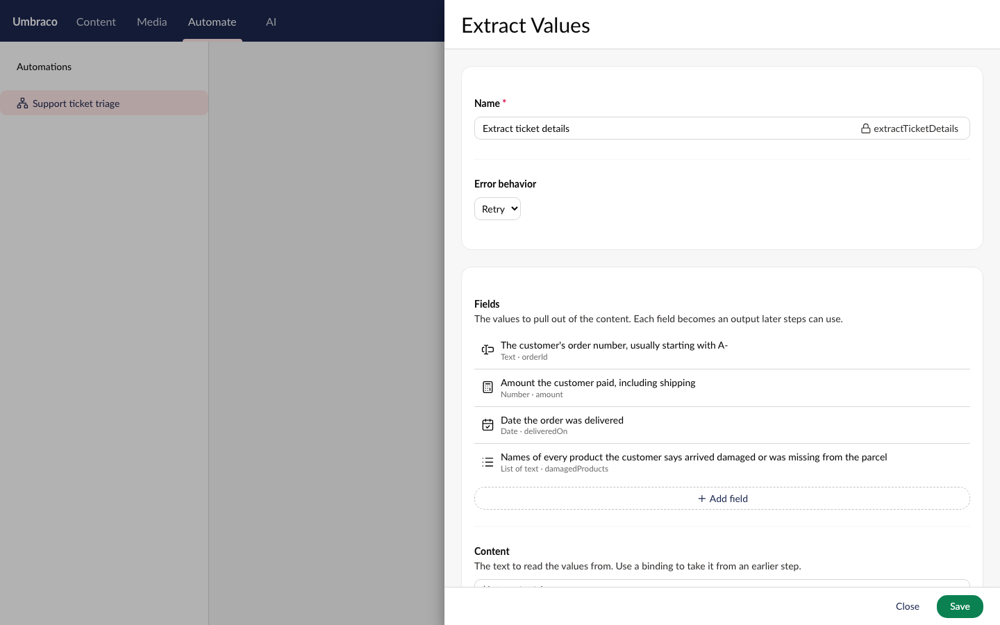
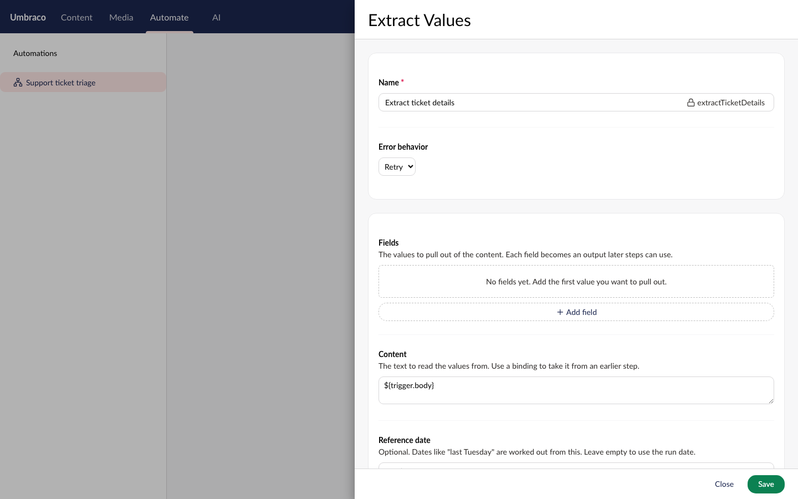
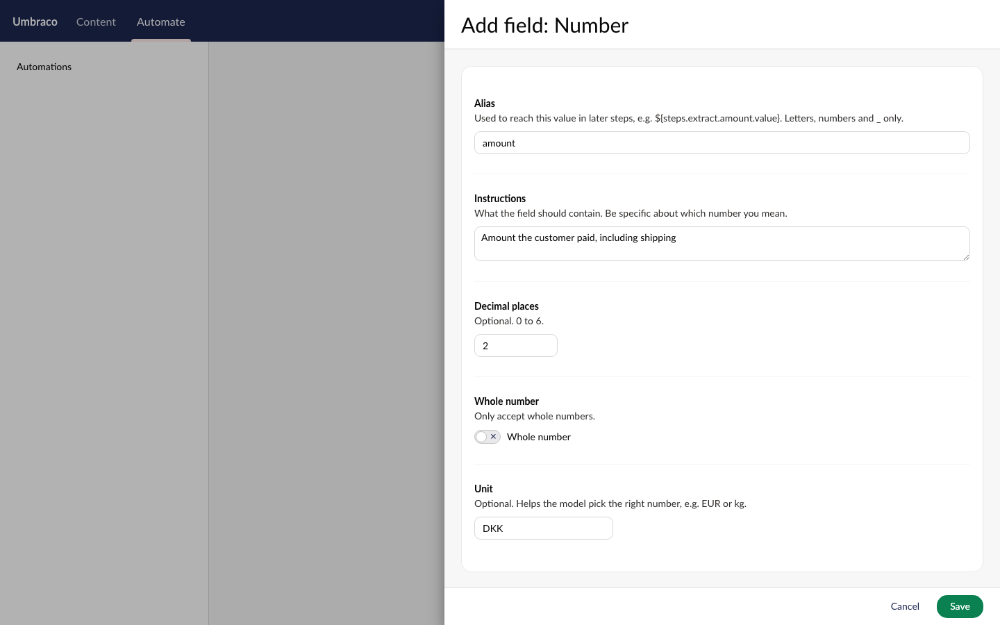
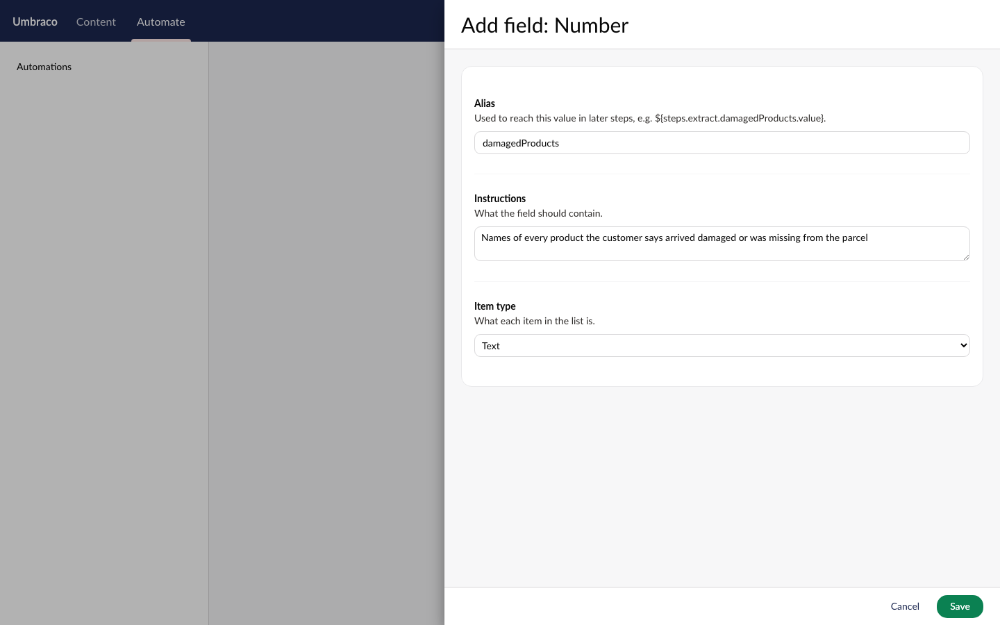
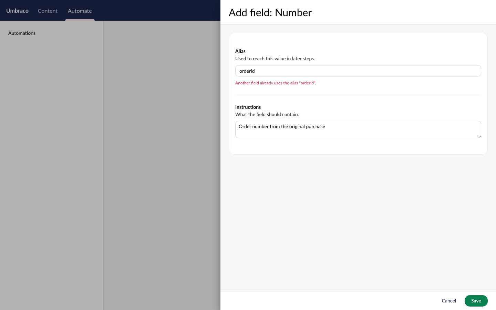

# Spec

What Extraction must observably do. Types and wiring are in `ARCHITECTURE.md`. Everything here
applies to both `v18/dev` and `v17/dev` unless it says otherwise.

## Experimental flag

- With `Umbraco:AI:Experimental:Extraction` off (the default):
  - Extraction isn't listed as a capability, no connections are returned for it, and creating an
    Extraction profile is rejected.
  - The Management API endpoint returns 404.
  - The settings screen has no default Extraction profile row.
  - The Automate "Extract Values" action isn't in the action list. An existing automation that
    still has the step fails it with a validation error ("Extraction is disabled.").
  - `IAIExtractionService` throws `InvalidOperationException`.
- With it on, all of the above work.

## Core behaviour (`IAIExtractionService`)

- **Profile resolution:** an explicit profile id or alias is used if given. Otherwise the default
  Extraction profile from settings is used, then `Umbraco:AI:DefaultExtractionProfileAlias`. If none
  resolves, or the profile isn't an Extraction profile, it throws `InvalidOperationException`.
- **Validation,** before any provider call (`ArgumentException`):
  - zero fields
  - blank, duplicate or invalid field id (`^[A-Za-z_][A-Za-z0-9_]{0,63}$`)
  - blank instructions
  - blank state
  - decimals outside 0 to 6
- **Answers:**
  - Every field in the request gets exactly one answer of its matching type, keyed by field id.
  - A missing, extra or wrong-type answer from a provider becomes an `AIProviderException`.
  - A value not in the content comes back as `Value == null` (empty list for list fields), with
    `IsFound == false`. Never a guessed value.
- **Typed values:**
  - text → `string`, with an optional span
  - number → `decimal`
  - date → `DateOnly`
  - time → `TimeOnly`
  - datetime → `DateTime`
  - duration → `decimal` in the requested unit
  - list → `IReadOnlyList<string>`
- **Confidence and NullProbability** are passed through when the provider reports them, otherwise
  `null`.
- **Tracking:**
  - Each call writes one usage record and one audit entry with capability `Extraction`.
  - It fires `AIExtractionExecutingNotification` (cancelling it stops the call) and
    `AIExtractionExecutedNotification`.
  - It emits one OpenTelemetry span.
- **Nested calls:** an extraction made inside another AI call gets its own runtime context (nested
  call test, per the `add-ai-capability` skill).

## Cloudflare provider (`Umbraco.AI.Cloudflare`)

- **Connection fields:** Account ID (required), API token (required, masked and encrypted like
  other sensitive fields), Endpoint (default `https://api.cloudflare.com/client/v4`).
- **Connection test:**
  - Valid account ID and token → passes.
  - Wrong token or account → fails with Cloudflare's own error message.
  - No tokens are spent.
- **Capabilities:** Extraction only. One model: `@cf/cloudflare/clairic`.
- **Request mapping:**
  - Each field is sent under its id with its type, instructions, and options: `decimals`,
    `integer`, `unit`, and `items` for lists.
  - `ReferenceDate` is sent as `reference_date`.
  - Images are never sent.
- **Response mapping:**
  - `value` → `Value`, `confidence` → `Confidence`, `p_null` → `NullProbability`.
  - `span` → `Span`, `spans` → `Spans`.
  - `usage.input_tokens` / `output_tokens` → usage.
  - Works whether or not the body is wrapped in Cloudflare's `{ result, success, errors }` envelope.
- **Errors:**
  - A 429 is retried up to 3 attempts in total, waiting no more than 30 seconds between tries.
  - Any other failure throws with Cloudflare's error code and message when the body has them.

## Management API surface

`POST /umbraco/ai/management/api/v1/extraction/extract`. It uses the same auth as the Decision
endpoint and is hidden (404) when the flag is off.

Request:

```json
{
  "profileIdOrAlias": "cloudflare-clairic",
  "state": "Order A-88412 was delivered on 3 October. I paid 701,10 kr. The mug and teapot were broken.",
  "referenceDate": "2026-10-20",
  "fields": [
    { "$type": "text",   "id": "orderId",  "instructions": "The order number" },
    { "$type": "number", "id": "amount",   "instructions": "Amount paid", "decimals": 2, "unit": "DKK" },
    { "$type": "date",   "id": "deliveredOn", "instructions": "Delivery date" },
    { "$type": "list",   "id": "damaged",  "instructions": "Damaged products", "itemType": "text" }
  ]
}
```

Response 200:

```json
{
  "answers": {
    "orderId":     { "$type": "text",   "value": "A-88412", "span": { "start": 6, "end": 13 }, "confidence": 0.9999, "nullProbability": 0.00001, "isFound": true },
    "amount":      { "$type": "number", "value": 701.10, "confidence": 0.9999, "nullProbability": 0.00002, "isFound": true },
    "deliveredOn": { "$type": "date",   "value": "2026-10-03", "confidence": 0.998, "nullProbability": 0.0001, "isFound": true },
    "damaged":     { "$type": "list",   "values": ["mug", "teapot"], "spans": [{ "start": 64, "end": 67 }, { "start": 72, "end": 78 }], "confidence": 0.99, "isFound": true }
  },
  "modelId": "@cf/cloudflare/clairic",
  "usage": { "inputTokens": 612, "outputTokens": 0, "totalTokens": 612 }
}
```

- Answer keys are the field ids exactly as sent (no camel-casing).
- A named profile that doesn't exist returns 404 `ProblemDetails`. A validation problem, no default
  profile, a profile of the wrong capability, or a provider error returns 400 `ProblemDetails`.
  Both match the Decision endpoint.

## Frontend components

All in `Umbraco.AI.Web.StaticAssets` (`@umbraco-ai/core`) unless noted.

- **`UaiExtractionController`:** exported from `@umbraco-ai/core`, with `extract(request)` returning
  typed answers. Same layering as `UaiDecisionController` (controller → repository → server data
  source). On v17 the data source maps the concrete generated field and answer models (no base
  `$type`), as Decision's does.
- **Profile editor:** an Extraction profile shows the shared "No settings available" message, like
  Decision.
- **Capability label and icon:** `uaiCapabilities.extraction` = "Extraction", icon `icon-filter`.
  It shows up wherever capabilities are listed (connection capabilities, profile create, usage
  dashboards).
- **Settings screen:** a "Default Extraction profile" picker row (picker filtered to Extraction
  profiles), shown only when the flag is on. It saves to `defaultExtractionProfileId`.
- **Cloudflare connection editor:** generated from the provider's settings fields. No custom UI.

### Extract Values step settings (Automate)



[Mockup source](./mockups/extract-values-settings.html)

First run, before any field is added:



- **Fields list:** the editor is `Uai.PropertyEditorUi.ExtractionFieldList`, configured with
  `max: 20`.
  - Each row shows the instructions as its name, and "Type · alias" underneath.
  - Clicking a row (or Edit) opens the field modal with the saved values.
  - Remove deletes the row straight away; it's gone for good once the step is saved, like the
    Decision list.
- **Add field:** opens the item picker with seven types: Text, Number, Date, Time, Date and time,
  Duration, List. Picking one opens the field modal. Cancelling the modal returns to the picker.
- **More than 20 fields:** a validation message blocks saving the step.
- **No fields:** the step can be saved, but the output schema is empty and the step fails at run
  time with a validation error. Same as Ask Questions.
- **Content:** bindable text. An empty value at run time fails the step with a validation error.
- **Reference date:** bindable, optional.
  - Must resolve to an ISO date (`yyyy-MM-dd`) or an ISO date-time.
  - Anything else fails the step with a validation error.
  - When empty, the run date (UTC) is used.
- **Profile:** a profile picker filtered to Extraction profiles. Empty means the default Extraction
  profile.
- **Outputs**, for later steps to bind to:
  - `<alias>.value`
  - `<alias>.found` (true or false)
  - `<alias>.confidence` (number, or empty when the provider gives none)

  Every alias is always present, even when the value wasn't found.

> The panel matches Automate's real step settings modal (`node-settings-modal`): medium size
> (800px), the action name as headline, Automate's own Name/alias and Error behavior box, then the
> action's settings stacked label-on-top, with Close and Save. Only the second box is this feature's
> work; the rest is Automate's and shown for context. The flow canvas behind is a stand-in.

### Field config modal



[Mockup source](./mockups/extraction-field-config.html)

List field variant and the duplicate-alias mistake:




- **Every type** has Alias and Instructions, both required.
- **Alias rules** (checked on Save; the modal stays open on a mistake, with the message under the
  field):
  - It must start with a letter and use only letters, numbers and `_`, to match Automate's alias
    rule.
  - It must not be used by another field in the list.
- **Extra settings by type:**
  - **Number:** Decimal places (optional, 0 to 6), Whole number (toggle), Unit (optional text).
  - **Duration:** Unit (select: seconds, minutes, hours, days, weeks, months, years; default
    seconds), Decimal places, Whole number.
  - **List:** Item type (select: Text, Number, Date; default Text).
  - **Text, Date, Time, Date and time:** nothing extra.
- **Headline:** "Add field: <Type>", or "Edit field: <Type>" when editing.
- **Save** returns the field to the list. **Cancel** discards changes.

### Five moments

- **First run:** shown in the empty mockup. On the settings screen, the default Extraction picker
  starts empty, like other capabilities.
- **Mistake:** shown in the duplicate-alias mockup. Run-time mistakes (empty content, bad reference
  date, no profile) fail the step with a readable validation error in the run log.
- **Wait:** extraction runs inside the automation, so there's no editor-facing wait. The backoffice
  client call uses the existing request loading state, like Decision.
- **Finish:** the step's outputs appear in the run detail, like other actions. Nothing new.
- **Return:** reopening the step shows the saved fields in order. Nothing extra to design.

## Non-functional targets

- No hot path: extraction never runs on a front-end page request.
- At most 20 fields per Automate step, matching Ask Questions. Core itself sets no limit.
- At most 3 attempts per provider call, with no single wait over 30 seconds (copies TypeSafe).
- > ASSUMPTION: Default `HttpClient` timeout (100 seconds) per attempt is acceptable. Clairic usually
  > answers in under a second.
- Every new screen element follows the existing Decision list and modal: keyboard reachable, with
  labels on every input.
- New frontend strings are localization keys in `lang/en.ts`. Generic words (Cancel, Save, Edit,
  Remove) reuse the existing general keys.

## Known risk carried into build

- **Numbers in Automate are culture-formatted:** Automate turns step outputs into strings with the
  server's culture. On a Danish (`da-DK`) server, a confidence of `0.85` may become `"0,85"`, which
  breaks `If confidence greater than 0.8`. This is in Automate, not this feature, and it already
  affects the Decision actions. Not verified by a test yet.
  - The build should check it on the demo site.
  - It should be raised with the Automate team. Per team practice, the issue states the problem and
    the expected behaviour only, with no suggested fix.
