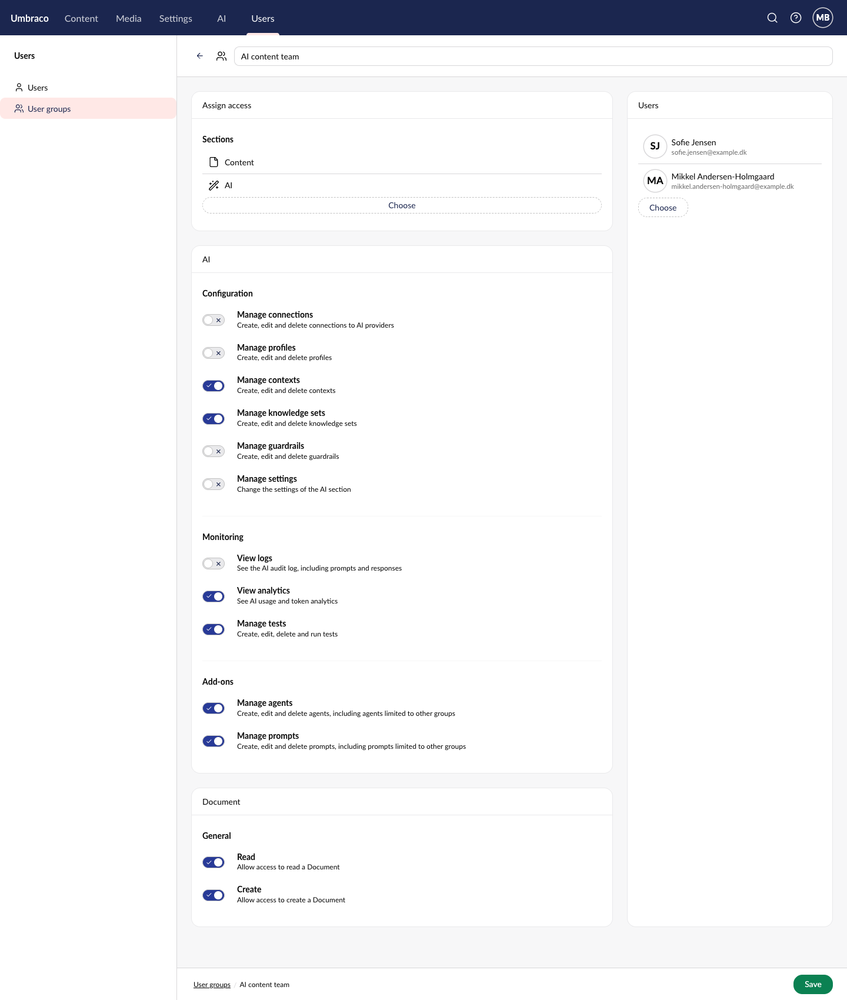
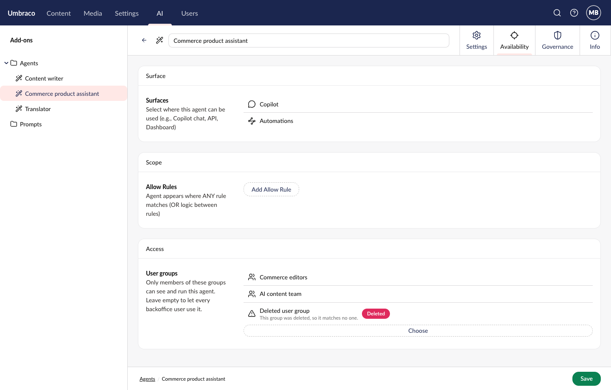
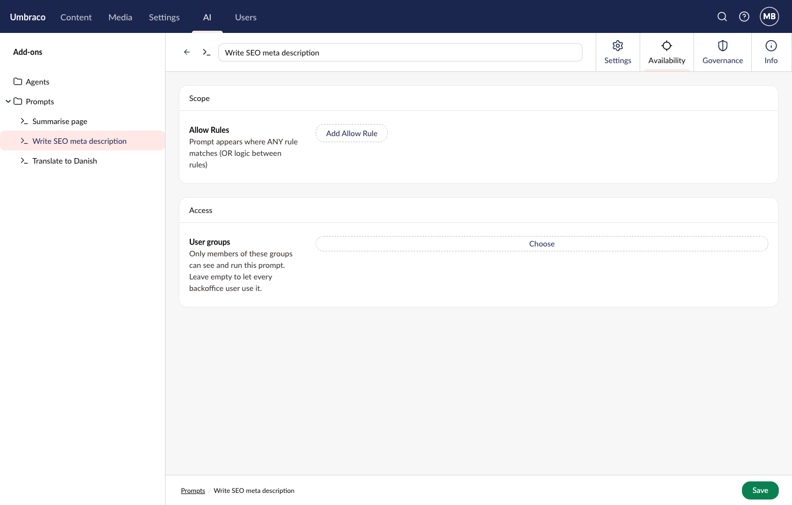

# Spec: Granular permissions

> [!IMPORTANT]
> **5 guesses need your OK.**
>
> 1. Deleting audit log entries and running the audit log cleanup need **Manage settings**, not
>    View logs. Viewing and deleting are different jobs, and the area only has a view right.\
>    *If not:* they need View logs, so anyone who can read the log can also delete it.
> 2. Rolling back an agent, prompt, connection or other entity to an old version needs that
>    area's manage right, the same as saving it.\
>    *If not:* rollback stays open to anyone with the AI section, which is a way to change an
>    area without its right.
> 3. A Deploy import of an agent or prompt fails when one of its user groups doesn't exist on
>    the target site, naming the missing group's alias. It never drops the group.\
>    *If not:* the missing group is dropped. If it was the only one, the agent opens up to
>    everyone on that site.
> 4. A run that is refused because of a group limit returns **403** with a message. The detail
>    endpoint returns **404** for an agent or prompt the user can't use, the same as one that
>    doesn't exist.\
>    *If not:* both return 404, which hides even more but gives Copilot Workspace and
>    integrators no clear reason.
> 5. Only an admin can empty an agent's or prompt's user group list, since an empty list opens
>    it to everyone. A non-admin can remove groups (R12) but not the last one.\
>    *If not:* a member of the only group on the list can remove it and open the agent to
>    everyone.

## Rights

Each right is one CMS user group permission. All of them show in one **AI** box on the user
group screen.

```text
Right                  Verb                     Group on screen   Product
Manage connections     Uai.Connection.Manage    Configuration     Umbraco.AI
Manage profiles        Uai.Profile.Manage       Configuration     Umbraco.AI
Manage contexts        Uai.Context.Manage       Configuration     Umbraco.AI
Manage knowledge sets  Uai.KnowledgeSet.Manage  Configuration     Umbraco.AI
Manage guardrails      Uai.Guardrail.Manage     Configuration     Umbraco.AI
Manage settings        Uai.Settings.Manage      Configuration     Umbraco.AI
View logs              Uai.AuditLog.View        Monitoring        Umbraco.AI
View analytics         Uai.Analytics.View       Monitoring        Umbraco.AI
Manage tests           Uai.Test.Manage          Monitoring        Umbraco.AI
Manage agents          Uai.Agent.Manage         Add-ons           Umbraco.AI.Agent
Manage prompts         Uai.Prompt.Manage        Add-ons           Umbraco.AI.Prompt
```

## Endpoints

Base path: `/umbraco/ai/management/api/v1`

Every endpoint below also needs the AI section, as today. A request without the right gets
**403** and changes nothing.

**Endpoints that now need a right**

- **Manage connections:** `POST connections`, `PUT connections/{idOrAlias}`,
  `DELETE connections/{idOrAlias}`, `POST connections/{idOrAlias}/test`.
- **Manage profiles, contexts, guardrails:** the create, update and delete endpoints of each.
- **Manage settings:** `PUT settings`. Also audit log delete and cleanup (guess 1).
- **Manage tests:** test create, update, delete, run, run batch, run by tags, and test run
  delete.
- **View logs:** audit log list and detail.
- **View analytics:** usage summary, time series and breakdown.
- **Manage agents:** `POST agents`, `PUT agents/{idOrAlias}`, `DELETE agents/{idOrAlias}`.
- **Manage prompts:** `POST prompts`, `PUT prompts/{idOrAlias}`, `DELETE prompts/{idOrAlias}`.
- **Rollback** (`POST versions/{entityType}/{id}/{version}/rollback`): the manage right of the area
  that owns `entityType` (guess 2).

Read endpoints not listed keep their current check. Endpoints open to every backoffice user
today stay open.

**`GET agents`** gains two optional query values
- `includeRestricted` (bool, default false): with Manage agents, returns every agent.
  Without it, the value is ignored.
- `onBehalfOf` (string): `automate-workspace:<workspaceId>` lists the agents that workspace's
  service account can use, instead of the caller's.
- **200** `{ total, items: AgentItem[] }`, filtered to agents the caller (or the
  `onBehalfOf` user) can use, unless `includeRestricted` applies.
- **403** `onBehalfOf` names a workspace the caller can't access.
- **400** `onBehalfOf` has an unknown kind, or the workspace has no service account.

**`GET agents/{idOrAlias}`** also takes `onBehalfOf`
- **200** `AgentResponse`, which now includes `allowedUserGroupIds: string[]`.
- **404** the agent doesn't exist, or the caller can't use it and doesn't have Manage agents.

**`POST agents`, `PUT agents/{idOrAlias}`** take `allowedUserGroupIds: string[]` (user group keys).
Empty or missing means everyone.
- **403** the change to `allowedUserGroupIds` breaks R12. Nothing is saved.

**Agent run endpoints:** `POST agents/{idOrAlias}/run`, `…/stream`, `…/stream-agui`,
`…/suggest-starters`, `GET …/suggest-starters/availability`, and Copilot Workspace's
conversation stream.
- **403** `ProblemDetails` titled "Agent not available", when the caller can't use the agent.

**`GET prompts`, `GET prompts/{idOrAlias}`, `POST prompts`, `PUT prompts/{idOrAlias}`** change the
same way as agents, with `includeRestricted` and `allowedUserGroupIds`. No `onBehalfOf`.

**`POST prompts/{idOrAlias}/execute`**
- **403** `ProblemDetails` titled "Prompt not available", when the caller can't use the
  prompt.

## Rules

**Area rights**

- **R1** A user has a right when any of their groups has its verb. There is no admin bypass:
  the admin group gets the rights through the upgrade, like any other group.
- **R2** Without a right, the area is closed to the user in the backoffice: its menu item,
  create button, bulk actions, entity actions (create, delete) and save button are hidden,
  and its list and editor don't open from a direct URL either. The area's read endpoints
  stay open, so pickers keep working (R4).
- **R3** Without "View logs" or "View analytics", that menu item is hidden and its read
  endpoints return 403.
- **R4** Pickers keep working without a right. A user with Manage contexts but not Manage
  profiles can still pick a profile, because list endpoints don't check area rights.
- **R5** On upgrade, every group with the AI section gets every AI right that its products
  ship. The admin group gets them too, even if its AI section row is added later in the same
  upgrade.
- **R6** Each product grants its own rights. A site that installs Umbraco.AI.Agent later gets
  Manage agents for every group with the AI section at that point.
- **R7** Running the upgrade again adds nothing twice and never removes a right an admin
  turned off.
- **R8** A group given the AI section after the upgrade gets no AI rights until an admin ticks
  them.

**Agent and prompt limits**

- **R9** An agent or prompt with no groups chosen can be used by every backoffice user. All
  existing agents and prompts start that way.
- **R10** With groups chosen, a user can use it only if they are in at least one of them.
  Manage agents or Manage prompts doesn't change this outside the AI section.
- **R11** "Use" covers being listed (Copilot, Copilot Workspace, every picker, the prompt
  property action and toolbar), being picked automatically (agent selection), and being run
  or executed by any endpoint or service call.
- **R12** In the AI section, a user with Manage agents (or Manage prompts) sees and edits every
  agent (or prompt), limited or not, with one exception: the user group list. Copying the
  CMS's own rule for assigning user groups, someone who isn't an admin can only change that
  list on an agent (or prompt) they can already use, and can only add or remove groups they
  belong to. Admins can change it freely. This stops anyone giving themselves an agent they
  can't already use.
- **R13** A limit and Scope are both applied. An agent must be in scope and usable.
- **R14** A deleted user group stays in a saved limit and matches no one. The editor shows it
  as "Deleted user group" so it can be removed.
- **R15** A Copilot Workspace conversation with an agent the user can no longer use stays
  readable. Sending a new message gets the 403.

**Automate**

- **R16** The "Run agent" step's picker lists only agents the workspace's service account can
  use.
- **R17** Publishing an automation fails when a "Run agent" step uses an agent the service
  account can't use. The error names the step and the agent.
- **R18** At run time, if the service account can't use the agent, the step fails with
  category `Authentication` and the reason "The workspace's service account can't use agent
  '<alias>'. Add one of its user groups to the agent, or pick another agent."
- **R19** If the workspace has no service account, the step fails, as Automate already does.
  An agent with a limit is never run without a known user.

**Deploy**

- **R20** An agent's or prompt's user groups travel by alias and are matched to the target
  site's groups by alias.
- **R21** An import fails, and says which alias, when a group doesn't exist on the target site
  (guess 3).

## User group screen

Opens from Users > User groups > a group. The CMS draws this screen. The package only adds
the **AI** box through `entityUserPermission` manifests.



[Mockup source](./mockups/user-group.html)

- A right shows only when its product is installed. Without Umbraco.AI.Agent there is no
  Manage agents row.
- Turning a right on or off takes effect on the user's next request. The backoffice menu
  updates after the user reloads.
- The five moments are the CMS's own on this screen (save toast, validation, loading).

## Agent editor: Access

Opens from AI > Agents > an agent > Availability.



[Mockup source](./mockups/agent-access.html)

| When | The screen |
|---|---|
| Choose clicked | Opens the CMS user group picker modal |
| A group was deleted | Shows "Deleted user group" with a Deleted tag (R14) |
| Saved | The editor's existing "Saved" toast |
| Reopened | Shows the saved groups |
| The user may not change the list (R12) | The field is read-only |
| The user may change it | The picker lists only their own groups (all groups for an admin) |

- Only users with Manage agents reach this screen (R2).
- The tag uses `color="danger"`, since the deleted group locks out everyone who isn't in the
  other groups.

## Prompt editor: Access

Opens from AI > Prompts > a prompt > Availability. Same field and behaviour as the agent
editor. The mockup shows the empty state every prompt has after the upgrade.



[Mockup source](./mockups/prompt-access.html)

## Screens not drawn

- **AI section for a user with some rights.** It's the current section with menu items and
  buttons removed (R2). Nothing new is drawn.
- **Automate "Run agent" step.** The picker looks the same. Only its list changes (R16).

## Targets

- Agent and prompt list endpoints filter in the same database query as today. No extra query
  per agent or prompt, and no loading every row to filter in memory.
- A right check adds no database query per request. It reads the groups already loaded on
  the current user.
- The Access field is the CMS's own picker, so keyboard and screen reader use matches the
  rest of the backoffice.
