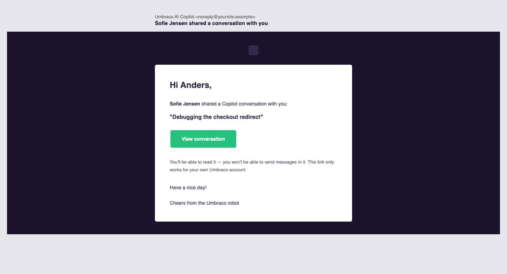
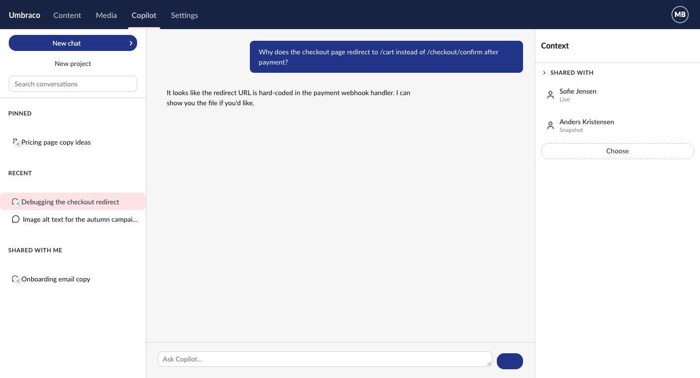
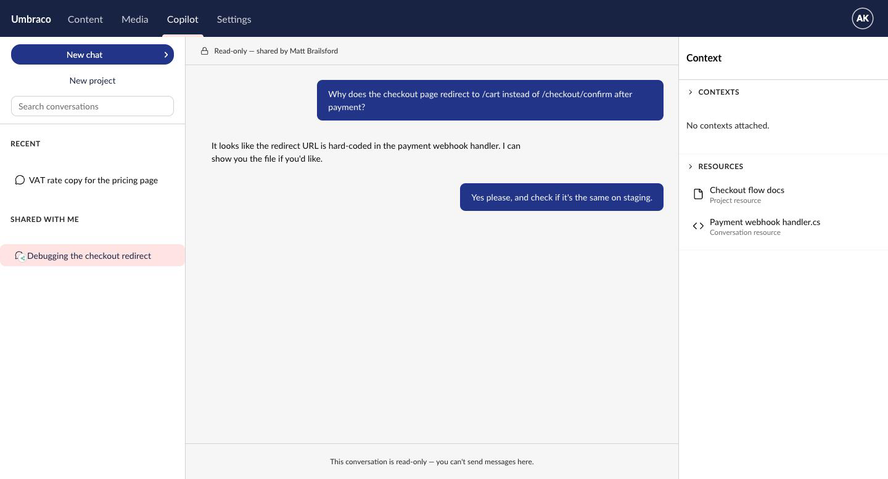

# Spec

## Management API surface

All routes are rooted at the existing `conversations` segment
(`ConversationsManagementApiConstants.Conversations.RouteSegment`), versioned `1.0`, behind the
existing backoffice section `[Authorize]` policy. Owner-only endpoints return the existing
not-found-vs-forbidden-indistinguishable 404 (`ConversationNotFound()`) so a non-owner can't probe
which conversation ids exist, exactly like `DeleteConversationController` does today.

### Existing `GET /conversations` (owner's paged list) gains `hasActiveShares`

`ConversationResponseModel` (and the `AIConversation` domain model it maps from) gains one new
read-only field: `hasActiveShares: boolean`. Server-computed per row in the existing paged query
(see `ARCHITECTURE.md` decision 6) — never accepted from a client. No other change to this
existing endpoint's request or behavior.

### `POST /conversations/{id}/shares` — create or update shares (owner-only)

Request:
```json
{
  "recipientUserKeys": ["<guid>", "..."],
  "scopeMode": "snapshot" | "live"
}
```

Behavior:
- 404 if `{id}` isn't owned by the acting user (indistinguishable from not-found).
- For each `recipientUserKey`: creates a new share row, or updates the existing one (recipient
  already shared with) rather than erroring — idempotent.
- `scopeMode: "snapshot"` sets `CutoffMessageId` to the id of the conversation's current last
  message, resolved server-side — never accepted from the client, the same "never trust
  caller-supplied identity of what's being frozen" posture as `UserKey` elsewhere in this service.
  `scopeMode: "live"` leaves it `null`.
- For each recipient a **new** share row is created for (not an update to an existing one): sends
  them an email via `SendEmailNotification` (see `ARCHITECTURE.md` decision 5), naming the owner
  and linking to the shared conversation. Updating an existing recipient's scope does not send a
  second email.

  

  [Mockup source](./mockups/share-notification-email.html)

  Built to the real shape Umbraco's own HTML notification emails use (checked against
  `Umbraco.Cms`'s `mailBodyHtml` template, not invented): a dark `#1d1333` header strip with the
  small Umbraco logo mark, a white 560px-wide card with `#392F54` heading/body text, a `#35C786`
  teal CTA button, and a plain one-line sign-off — no separate unsubscribe/legal footer exists in
  Umbraco's own templates, so this one doesn't invent one either. Entirely inline-styled, no CSS
  custom properties or UUI design tokens — the same mail-client-safe constraint every real Umbraco
  email already works within. Subject/body copy shown is illustrative only; exact wording is a
  `feature-build` TODO needing product/legal-adjacent review (see `ARCHITECTURE.md` decision 5).
- 200 with the resulting list of active shares for this conversation (same shape as the `GET`
  below).

### `GET /conversations/{id}/shares` — list current recipients (owner-only)

- 404 if not owned by the acting user.
- 200 with active (non-revoked) shares: `[{ userKey, userName, scopeMode, dateShared }]` — used by
  the Share modal's "currently shared with" list.

### `DELETE /conversations/{id}/shares/{userKey}` — revoke one recipient (owner-only)

- 404 if the conversation isn't owned by the acting user, **or** if there is no active share for
  that `userKey` (same indistinguishability principle).
- Sets `DateRevoked`; the row is kept, not deleted (see `ARCHITECTURE.md`'s "Why soft-revoke"
  rationale in the data model section).
- 204 No Content. The recipient loses access on their next request — no other side effect.

### `GET /conversations/shared-with-me` — the recipient's list (paged)

Parallel to the existing `GET /conversations` (`AllConversationsController`), but sourced from
active shares where the acting user is the recipient, not from owned conversations.

- Query params mirror the existing list endpoint where they still make sense: `skip`, `take`,
  `search`. `projectId`/`includeArchived` do not apply (shared conversations aren't grouped into
  the recipient's own projects, and archiving is an owner-only concept) and are omitted.
  `search` matches **title only** — not message content like the owner's own list endpoint does.
  A Snapshot share hides messages after its cutoff from the recipient; matching message content
  here would let a search hit (or miss) leak whether a word exists past that cutoff, through a
  channel the cutoff is supposed to close. Title-only is a deliberate narrowing, not an oversight.
- 200 `PagedViewModel<SharedConversationSummaryResponseModel>` — conversation id, title, owner's
  display name, `scopeMode`, `dateShared`. No message content in the list view.

### `GET /conversations/{id}/shared-view` — the recipient's read (single conversation + messages)

- 404 if there is no active (non-revoked) share for `{id}` addressed to the acting user.
- 200 `SharedConversationResponseModel`:
  - Conversation metadata (title, agent, dates) — same shape as the owner's response model, minus
    owner-only fields (`isPinned`, `isArchived`, `projectId`).
  - `messages`: for a `Snapshot` share, every message whose `Sequence` is `<=` the `CutoffMessageId`
    message's `Sequence` (resolved at read time); for a `Live` share, all messages. Both in the
    existing ascending order. If the `CutoffMessageId` message no longer exists (e.g. the owner
    used regenerate and truncated past it), falls back to every message that still exists — never
    an error.
  - `resources` / `contextIds`: unfiltered — the same attachment list the owner sees. See
    `ARCHITECTURE.md` decision 2 for why; the corresponding disclosure happens at share time, in
    the Share modal (below), not by filtering the read.
- No write operations exist on this route or any other route for a non-owner. There is no
  "shared" variant of send-message, rename, delete, truncate, or attach-resource.

## Frontend components

All in `Umbraco.AI.Agent.Copilot.Workspace.Web.StaticAssets`, following existing patterns in the
`conversation/` feature folder.

### Context panel "Shared with" section — the only entry point into sharing



[Mockup source](./mockups/sidebar-shared-indicator.html) ·
[Share picker modal mockup](./mockups/share-picker-modal.png) ·
[source](./mockups/share-picker-modal.html)

Per `ARCHITECTURE.md` decision 7 — no entity action, no separate manage-view modal. Sharing works
exactly like the panel's existing Contexts/Resources sections: a visible, directly-editable list.
A new "Shared with" `<details class="cw-context-block">` in `conversation-context-panel.element.ts`
(owner's own conversations only, `conversation.readonly === false`), rendered first, above Contexts:

- Each active recipient (from `GET .../shares`) renders as a `uui-ref-node` — name, scope mode
  ("Live"/"Snapshot") in the detail slot — with the same inline `uui-action-bar` trash-icon remove
  button `<uai-resource-list>`'s rows already use. Clicking it calls `DELETE .../shares/{userKey}`
  directly — no confirm step, same posture as the rest of this spec.
- Empty state: "Not shared with anyone yet." in place of the list.
- A "Choose" `uui-button look="placeholder"` — same control and label convention as the
  Contexts/Resources "+ Add" button — opens `UAI_SHARE_PICKER_MODAL`.
- Not shown at all for a conversation the acting user is only a *recipient* of — they already see
  who shared it with them via the read-only banner (below), and `GET .../shares` is owner-only so
  there's no data to show them here regardless.

### `UAI_SHARE_PICKER_MODAL` — pick one person + a mode

A single-recipient form, opened directly by "Choose" above — repeatable, one person per
invocation, the same way adding one resource is one picker invocation:

- **Recipient**: a one-item picker field (same shape as a content-picker property editor): empty
  shows a "Choose a person" placeholder button that opens the real `UMB_USER_PICKER_MODAL`
  (`@umbraco-cms/backoffice/user`) to pick one user — the first use of it in this codebase, used
  with a max-of-one constraint rather than a new lighter wrapper (see `ARCHITECTURE.md` decision
  7). Once picked, the field shows the chosen person as one `uui-ref-node`, re-pickable by clicking
  it again.
- **Mode**: a `uui-select` dropdown (Snapshot/Live), not radio buttons — mirrors this codebase's
  own pattern for a small fixed-option choice (see `agent-details-workspace-view.element.ts`'s
  output-format dropdown).
- **Disclosure banner**: unchanged from earlier passes — only renders when the conversation has any
  `contextIds`/`resources` attached. Not a confirmation the owner has to actively dismiss beyond
  the normal submit; exact copy is a TODO for `feature-build` (see `ARCHITECTURE.md` decision 2).
- Submitting (`POST .../shares` with the one picked recipient + mode) closes the modal; the
  "Shared with" section re-fetches `GET .../shares` so the new row appears immediately.
- Must observably: disable submit until a person is picked, surface errors through the same
  toast/notification pattern other conversation actions already use, and let the owner repeat the
  flow to add more than one recipient (each a separate picker invocation).

### `conversation.repository.ts` additions

- `share(conversation, recipientUserKey, scopeMode)` → `POST .../shares`
- `getShares(conversation)` → `GET .../shares`
- `revokeShare(conversation, userKey)` → `DELETE .../shares/{userKey}`
- `requestSharedWithMe(skip, take, search?)` → `GET /conversations/shared-with-me`
- `requestSharedView(id)` → `GET /conversations/{id}/shared-view`

> ASSUMPTION: the `POST .../shares` request body still accepts `recipientUserKeys` as an array
> (per the Management API section above) even though this UI only ever sends one — keeps the
> endpoint usable by a future bulk entry point without a breaking change, at no cost to this one.

### Sidebar: "Shared with me" grouping + owner's "this is shared" indicator


[Mockup source](./mockups/sidebar-shared-indicator.html)

Both groupings use the identical row shape — one icon (with an entity-sign badge overlay), one
line of text, no second line — so a shared-with-me entry isn't a visually different kind of row
from the owner's own shared entries, just a different group.

**"Shared with me" grouping:**
- A new group in the existing conversation sidebar list, visually parallel to the existing
  Pinned/Recent groupings, sourced from `requestSharedWithMe()`.
- Each entry renders like any other tree item: title only, plain chat icon with the same
  `Uai.Conversation.IsShared` entity-sign badge overlay described below — no owner-name subtitle
  row. The owner's name isn't dropped as information, just moved: hovering the badge on one of
  these entries shows "Shared by \<owner\>" (vs. plain "Shared" on the owner's own rows), and
  opening the conversation shows the same owner name again in the read-only banner (below).
- Only a "View" affordance — no Pin/Archive/Rename/Move/Delete entity actions render for shared
  entries; those remain exclusively on the owner's own conversations.
- **Not** a separate section or tab — reuses the one existing sidebar list surface, since Copilot
  Workspace doesn't have a second navigational area today and this feature doesn't need one.

**Owner's own tree item — "this is shared" indicator** (the "Debugging the checkout redirect" row
in the mockup, under Recent): a real Umbraco **entity sign** (flag badge), per `ARCHITECTURE.md`
decision 6 — not an icon swap. `uai-copilot-workspace-conversation-tree-item` wraps its existing
icon (pin if `isPinned`, else plain chat icon — unchanged) in `<umb-entity-sign-bundle
.entityType="uai-conversation" .entityFlags=${hasActiveShares ? [{ alias:
'Uai.Conversation.IsShared' }] : []}>`, and a new `entitySign` manifest
(`forEntityTypes: ['uai-conversation']`, `forEntityFlags: ['Uai.Conversation.IsShared']`, `kind:
'icon'`, `iconName: 'icon-share'`, `iconColorAlias: 'positive'`) renders it as a small corner badge
over whichever main icon is showing. Pinned and shared now show **simultaneously** — a pinned,
shared conversation has both the pushpin and the badge at once. Hovering the badge shows its label
as a tooltip ("Shared") without opening anything. "With whom" is answered by opening the
conversation and looking at the context panel's "Shared with" section (below) — not a tooltip on
the row itself, and not a separate entity action (there isn't one — see `ARCHITECTURE.md` decision
7). The exact icon name (`icon-share`) and color alias (`positive`) are `feature-build` details to
confirm against the real icon/color sets, not decided here.

### Chat detail view and context panel: read-only mode



[Mockup source](./mockups/read-only-shared-conversation.html)

The lock icon + "Read-only — shared by \<owner\>" banner replaces the composer entirely (not just
disables it) — matches the mockup's bottom bar ("This conversation is read-only — you can't send
messages here"), reusing the archived-conversation `readonly-notice` mechanism with different
text. The context panel shows the same two attachments the owner sees (per `ARCHITECTURE.md`
decision 2 — nothing filtered), with no "Choose"/add affordance since the panel is read-only.

A read-only mode already exists — it's what archived conversations use today — and this feature
extends it rather than building a parallel mechanism, across both surfaces that need to respect it.

**Today:** `UaiConversationWorkspaceContext` (the single store both the chat and the context panel
observe) exposes `isReadonly$ = c?.isArchived ?? false`. `conversation-chat-view.element.ts`
observes it and passes it straight through to the shared `<uai-chat readonly
readonly-notice="...">`, which hides the composer and shows a localized notice when `readonly` is
true. The context panel, however, does **not** consume `isReadonly$` — its resource and context
pickers check `conversation.isArchived` directly, in four separate places, to decide whether "add a
resource/context" is enabled.

**Extension:**
- `UaiConversationDetailModel` gains an `isShared: boolean` field (alongside the existing
  `isPinned`/`isArchived`), following the same flat-boolean shape, plus a single derived
  `readonly: boolean` computed once at mapping time (`isArchived || isShared`).
- `isReadonly$` becomes `c?.readonly ?? false` (was `c?.isArchived ?? false`) — a shared
  conversation is read-only for exactly the same reason an archived one is: no writes are ever
  valid against it.
- The context panel's four `conversation.isArchived` checks switch to `conversation.readonly`
  instead — one field every consumer reads, rather than each site individually growing an
  `|| conversation.isShared`. Without this, a shared conversation's context panel would render
  working-looking "add a resource/context" controls that silently fail, since there's no write
  endpoint for a shared view. It shows the same (unfiltered — see `ARCHITECTURE.md` decision 2)
  resource list the owner sees; it just can't be edited.
- `UaiConversationWorkspaceContext.#reload()` needs a second path: when the route target is a
  shared conversation, it calls the new `requestSharedView(id)` instead of the owner's
  `requestById(id)`, and maps the `SharedConversationResponseModel` into
  `UaiConversationDetailModel` via a new `toSharedConversationDetailModel()` (parallel to the
  existing `toConversationDetailModel()`) that sets `isShared: true` and leaves
  `isPinned`/`isArchived` at their defaults, since those concepts don't apply to a share.
- The `readonly-notice` text varies by *why* it's read-only (archived vs. shared-by-\<owner name\>)
  — `conversation-chat-view.element.ts` already passes this as a plain attribute, so this is a
  matter of picking the right localized string (a new `uaiCopilotWorkspace_sharedReadOnlyNotice`,
  likely interpolating the owner's display name) based on `isArchived` vs `isShared`, not a new
  plumbing mechanism.
- Message rendering itself (text, tool calls, attachments) is entirely unchanged — reusing the
  existing renderer is the main reason to extend the existing components rather than building
  parallel ones.

## Non-functional targets

- No new scale concern: shares live in a child table keyed and indexed the same way
  `AIConversationResourceEntity` already is, and `hasActiveShares` is computed in the existing
  paged-list query rather than a per-row round trip (see `ARCHITECTURE.md` decision 6) — the owner's
  conversation list doesn't get slower as the number of shares grows.
- > ASSUMPTION: no explicit limit on the number of recipients a single share request can name.
  Internal-collaboration use case (a handful of colleagues), not a mass-distribution one — flag if
  a cap is actually wanted.
- Everything else is standard backoffice CRUD against an already-small (per-user) conversation
  list — no other non-functional target applies.
